# HR Nexus AI: Feasibility of AI-Powered Workforce Intelligence, Organizational Dynamics and HR Decision Support

**Research report, 31 October 2026.** Branch `mnasri`. All experiments can be reproduced with `python scripts/download_data.py && python scripts/run_all.py` (see the [README](../README.md)). Every number in this report comes from `results/*/metrics.json` or the CSV tables next to it.

> **Short answer.** Parts of HR Nexus are feasible and useful. Parts are scientifically unsupported, and in the EU some are illegal. Communication and task **metadata** can reconstruct how teams coordinate, and can surface silos, brokerage concentration and key-person dependency. In our experiments that held across real email and face-to-face data. Team-level coordination risk is predictable a few weeks ahead with modest accuracy (AUC 0.70-0.76). Metadata **cannot** stand in for what employees experience. On 8,463 US workers, hours-based signals predicted self-reported stress only weakly (AUC 0.64). What people *report* about their work predicted it much better (AUC 0.79). Inferring emotions from biometric signals at work has been prohibited in the EU since February 2025. The defensible product is therefore team-level, survey-anchored and privacy-first decision support. It is not a covert stress radar.

---

## Contents

1. [Executive summary](#1-executive-summary)
2. [Scientific background and related work](#2-scientific-background-and-related-work)
3. [Existing commercial and academic solutions](#3-existing-commercial-and-academic-solutions)
4. [Open-source dataset inventory](#4-open-source-dataset-inventory)
5. [Data availability and quality assessment](#5-data-availability-and-quality-assessment)
6. [Experimental results](#6-experimental-results)
7. [Graph architecture and organizational modeling](#7-graph-architecture-and-organizational-modeling)
8. [Well-being measurement feasibility](#8-well-being-measurement-feasibility)
9. [Predictive modeling feasibility](#9-predictive-modeling-feasibility)
10. [Multi-objective HR decision support](#10-multi-objective-hr-decision-support)
11. [Security and privacy threat model](#11-security-and-privacy-threat-model)
12. [Legal and regulatory considerations](#12-legal-and-regulatory-considerations)
13. [Proposed system architecture](#13-proposed-system-architecture)
14. [Technology stack](#14-technology-stack)
15. [Implementation roadmap](#15-implementation-roadmap)
16. [Limitations and unresolved research questions](#16-limitations-and-unresolved-research-questions)
17. [Final feasibility verdict](#17-final-feasibility-verdict)
- [Reproducibility](#reproducibility)
- [References](#references)

---

## 1. Executive summary

**What we did.** We ran seven experiments in Python. Six use real public data: SNAP email-Eu-core, SocioPatterns office contacts, UCI Absenteeism, the General Social Survey Quality of Worklife module, O\*NET 31.0 and the Anthropic Economic Index. Two use clearly labelled synthetic data where no real data exists: a multi-objective intervention simulator and an example organizational graph. We also reviewed the literature, the commercial market and the regulation, and we built a threat model.

**What the evidence says.**

| Claim in the concept | Verdict | Key evidence from this work |
|---|---|---|
| Reconstruct how teams work from metadata | **Largely yes** | Formal departments recovered from email structure with 73% accuracy (35 departments, 30% of labels known; chance 10%). Face-to-face contacts: 81%. Community detection NMI 0.57-0.80 (E2) |
| Detect silos, bottlenecks, key-person dependency | **Yes, at team level** | The top 1% of brokers carry 17.7% of cross-department ties, versus 1.6% for random people. Channels carried by 1-2 people collapse far more often than channels carried by 6+ (82% vs 37%; HR 0.31 per log-unit of carriers) (E2, E5) |
| Detect workload pressure | **Partly** | Tripled email load is detectable (AUC 0.89). A +25-50% surge is barely detectable (AUC 0.59-0.67). Because surges are rare, precision is below 20% (E1) |
| Predict coordination failures | **Modestly, at team level** | Collapse of inter-team channels predicted 1-3 months ahead with AUC 0.70-0.76 and PR-AUC 0.10-0.25. Weekly team load beats a naive forecast only at 2-8 weeks, with large errors (E5) |
| Estimate stress or burnout | **Only from what people report** | Hours and extra-hour days alone give AUC 0.64 for self-reported stress. Adding reported demands, resources and work-family conflict gives 0.79 (GSS, n=8,463). Email hours add nothing (E4) |
| Detect emotional states from digital activity | **No (and prohibited in EU workplaces when based on biometrics)** | Lab-only evidence, poor generalization across studies [40-46]; AI Act Art. 5(1)(f) [71] |
| Link well-being to future performance | **Not testable with public data** | No public dataset combines validated well-being, objective performance and time. IBM's popular "HR attrition" data is fictional and its satisfaction items are mutually uncorrelated (max abs rho = 0.04) (E4) |
| Map work to skills and capability gaps | **Yes, with several artifacts** | From one task text: top-5 occupation accuracy 51%. From five: 84%, with a skill-profile error of 0.13 on a 1-5 scale versus 0.63 for a random guess (E3) |
| Compare HR interventions | **Yes as transparent what-if, not as prediction** | The ranking of options depends on unmeasured assumptions. The simulator shows the trade-off; it does not prove a well-being effect (E6) |

**Recommendation.** Build HR Nexus as a **team-level organizational-health and coordination-risk platform**. It joins three sources:

- metadata-derived structure: collaboration graph, dependencies and load, aggregated with k >= 5;
- validated, voluntary, anonymous psychosocial surveys (COPSOQ or BAT);
- skills taxonomies (O\*NET or ESCO).

It presents multi-objective what-if scenarios with explicit assumptions. Exclude from the product:

- individual stress, burnout, emotion or "risk" scores;
- keystroke and screen monitoring;
- message and prompt content analysis by HR;
- individual productivity rankings;
- automated personnel decisions.

**Final scorecard** (details in Section 17):

| Dimension | Score /100 |
|---|---|
| Scientific feasibility | 55 |
| Data availability | 35 |
| Technical feasibility | 75 |
| Predictive reliability | 35 |
| Graph intelligence potential | 70 |
| HR usefulness | 60 |
| Security and privacy feasibility | 50 |
| Implementation complexity (higher = harder) | 70 |
| Hackathon MVP feasibility | 80 |
| Long-term commercial potential | 50 |

---

## 2. Scientific background and related work

### 2.1 Organizational network analysis (ONA)

Communication networks reveal informal structure that the org chart hides. Kossinets & Watts studied university email [15]. Michalski et al. compared email structure with the formal hierarchy of a manufacturing company [14]. Yang et al. studied 61,182 Microsoft employees and found that firm-wide remote work made collaboration networks more static and siloed, with fewer bridging ties [12]. Network position correlates with performance in some settings: Aral, Brynjolfsson & Van Alstyne found that email network structure predicted recruiter output [13]. Brokerage across structural holes is associated with good ideas [21].

These are **correlational, context-specific** findings. Centrality is not a measure of value. Cross, Rebele & Grant document "collaborative overload": the most central people are often the most overloaded [18]. Leonardi & Contractor argue for *relational* analytics over attribute analytics [19].

Standard tools apply directly:

- Brandes' betweenness algorithm [23];
- modularity-based community detection: Louvain [24] and Leiden [25];
- the Krackhardt-Stern E-I index for group openness [22].

### 2.2 Sensing work, and its limits

Sociometric badges captured face-to-face interaction and showed links to team outcomes [16]. They also showed that open-plan offices *reduced* face-to-face interaction [17]. For stress, the evidence base is thin:

- **Lab studies.** SWELL-KW induced time pressure and interruptions in 25 participants and combined computer-interaction, posture, facial and physiological sensors [41, 42]. Effects on reported mental effort were detectable. Generalization is unproven.
- **Field studies.** Tesserae followed 757 information workers with phone, wearable and Bluetooth beacons [45]. Its data are not public.
- **Generalization.** Passive-sensing models for mental health generalize poorly across studies and cohorts [43, 44]. Social-media mental-health prediction suffers from construct-validity problems [46].
- **Emotion expression.** Facial or behavioural expression is not a reliable readout of emotion [40].

### 2.3 Work-stress theory

The job demand-control(-support) model [29, 30] and the job demands-resources model [32] predict strain from high demands combined with low control, support and resources. Effort-reward imbalance [99] is an alternative model. Reviews find robust **additive** effects of demands, control and support. **Buffering interactions** are inconsistent [31, 89]. Experiment 4 replicates exactly this pattern on GSS data.

Long working hours have serious health consequences at population level. WHO/ILO attribute about 745,000 deaths in 2016 to working 55 or more hours per week [49]. Output per hour declines at long hours [50]. Burnout is classified by the WHO as an *occupational phenomenon*, not a medical condition [39].

### 2.4 Well-being and performance

Job satisfaction correlates with job performance at about rho = 0.30 [51]. Business-unit engagement correlates with unit outcomes [53]. Burnout's relationship with *objective* performance is weaker and inconsistent [52]. Psychological safety predicts learning and performance behaviours [37, 54]. None of these support predicting an individual's future performance from their well-being.

### 2.5 AI-assistant interaction data

In web search, query reformulation predicts searcher dissatisfaction [47]. AI-assistant reformulation is a plausible analogue but has not been validated as a friction measure. Clio [10] and the Anthropic Economic Index [9] show a privacy-preserving pattern: conversations are classified into tasks, only aggregated clusters above size thresholds are released, and the results map onto the O\*NET task taxonomy. In a field study of customer-support agents, generative-AI assistance raised productivity by about 14-15% on average, mostly for novices [48]. Aggregated AI-usage data could therefore indicate where knowledge is missing. It says nothing reliable about an individual's competence or state.

### 2.6 Simulation and decision support

Computational organization theory has modelled how work, coordination and exception handling interact. The Virtual Design Team is the canonical example [55]. Multi-objective optimization (NSGA-II [56]; pymoo [57]) and queueing results such as Little's law [59] give principled ways to show trade-offs without collapsing them into a single score. Causal claims about interventions need designs (randomization, difference-in-differences, target-trial emulation [58]), not just predictive models.

---

## 3. Existing commercial and academic solutions

Vendor descriptions below summarize public positioning. We did not test the products.

| Category | Examples | What they do | Relevance to HR Nexus |
|---|---|---|---|
| Collaboration analytics from M365/Google metadata | Microsoft Viva Insights (formerly Workplace Analytics); Worklytics | Aggregated meeting, email and chat metadata metrics, with de-identification and minimum group sizes | Closest competitor for Experiments 1-2. Viva enforces minimum group sizes (documentation cites 5 and 10 for different views; never below 5) [84] |
| ONA platforms | Polinode, TrustSphere-type relationship analytics, Humanyze (sensor plus digital) | Survey-based and passive network maps | Overlaps the graph layer |
| People-analytics platforms | Visier, Workday People Analytics, SAP SuccessFactors | HRIS-centric dashboards, attrition and workforce planning | Overlaps reporting, not graph or process analytics |
| Employee listening | Microsoft Viva Glint, Workday Peakon, Culture Amp, Qualtrics EX | Engagement and well-being surveys with confidentiality thresholds | Overlaps the survey layer |
| Skills intelligence | Eightfold, Gloat, Workday Skills Cloud, Lightcast | Skills inference and talent marketplaces | Overlaps Experiment 3 |
| Activity monitoring ("bossware") | ActivTrak, Teramind, Hubstaff | Individual screen, app and keystroke tracking | What HR Nexus must **not** become. Regulators have fined this kind of surveillance (Section 12) |
| Academic | MIT sociometric badges [16]; Microsoft Research collaboration studies [12]; Tesserae [45]; SWELL-KW [41] | Research prototypes and datasets | Methods and evidence base |

**Lesson from the market.** In December 2020 Microsoft's Productivity Score showed user-level activity. After a privacy backlash, Microsoft removed user names and moved to aggregate-only reporting [85]. Employers buy collaboration analytics, but individual-level visibility is commercially and reputationally toxic.

**Where the gap is.** Few products combine three things:

1. graph-based **coordination-risk** analytics, such as key-person dependency and channel fragility;
2. **validated** psychosocial surveys joined at team level;
3. **explicit multi-objective scenario comparison** with stated assumptions.

All of this sits under a governance model employees can see. Section 17, Q12 discusses whether that is enough to differentiate.

---

## 4. Open-source dataset inventory

### 4.1 Datasets downloaded and used here

All of these downloaded without login on 31 October 2026. SHA-256 hashes are in `data/raw/MANIFEST.json`.

| Dataset | Direct link | Size and variables | Format | Real or synthetic; collection | License | Privacy | Supports | Limitations |
|---|---|---|---|---|---|---|---|---|
| **SNAP email-Eu-core** + department labels [1, 2] | https://snap.stanford.edu/data/email-Eu-core.html | 1,005 people; 25,571 directed edges (642 self-loops); department of each person (42) | edge list `.txt.gz` | Real, anonymized email among members of a European research institution | No explicit licence on the page; distributed for research | IDs anonymized; structure is still re-identifiable in principle [62] | E2 | Static; unknown period; one institution; email only |
| **SNAP email-Eu-core-temporal** [3] | https://snap.stanford.edu/data/email-Eu-core-temporal.html | 986 people; 332,334 timestamped emails; "803 days" | `src dst t` `.txt.gz` | Real, as above | As above | As above | E1, E2 (stability), E5 | **Dense only for 75 weeks** (Section 5.3). Node IDs **do not match** the labelled static file (2% edge overlap) |
| **SocioPatterns "Contacts in a workplace" (InVS15)** [4, 5] | https://sociopatterns.org/datasets/contacts-in-a-workplace/ | 232 people (217 with contacts), 12 departments, 78,249 contact records at 20-s resolution over 11.5 days | `t i j` `.dat.gz` + metadata | Real; RFID badges in a French office building | CC0, as stated on the dataset page | Anonymous IDs | E2 replication | Short window; face-to-face only |
| **UCI Absenteeism at work** [6] | https://archive.ics.uci.edu/dataset/445/absenteeism+at+work | 740 absence records, 36 employees, 21 attributes (reason ICD code, workload index, hit target, BMI, drinking, smoking, ...) | CSV / ARFF / XLS | Real; courier company in Brazil, Jul 2007-Jul 2010 | CC BY 4.0 | **Contains health data** (ICD reasons, BMI) | E1 | Tiny; workload is an org-level monthly index |
| **General Social Survey, Quality of Worklife module** [7] | https://gss.norc.org/ (year files, e.g. `.../stata/2018_stata.zip`) | Six waves 2002-2022; 10,640 working respondents with the stress item; ~90 QWL items (hours, overload, autonomy, support, work-family, stress, "used up", satisfaction) | Stata `.dta` | Real; US probability sample; module designed by NIOSH | Free public use with citation | Public-use file, de-identified | E4 | Single-item measures, not CBI/COPSOQ; cross-sectional; no performance measure; 2022 is mixed-mode |
| **O\*NET 31.0** [8] | https://www.onetcenter.org/database.html | 923 occupations with 18,838 task statements; 35 skills and 33 knowledge areas (importance and level) | tab-separated text | Real; US DOL job-incumbent and analyst ratings | CC BY 4.0 | None (occupation-level) | E3 | US taxonomy; occupation-level, not person-level |
| **Anthropic Economic Index, release 2025-02-10** [9] | https://huggingface.co/datasets/Anthropic/EconomicIndex | 3,514 O\*NET tasks with share of Claude conversations | CSV | Real, **aggregated** (Clio pipeline [10]) | MIT, per the dataset card | Aggregated, privacy-preserving | E3 | One AI product; tasks keyed to an older O\*NET version (83% match to 31.0) |
| **IBM HR Analytics Employee Attrition** [11] | https://github.com/IBM/employee-attrition-aif360 (`data/emp_attrition.csv`); Kaggle mirror | 1,470 rows x 35 columns (OverTime, JobSatisfaction, WorkLifeBalance, PerformanceRating, Attrition, ...) | CSV | **Fictional**, created by IBM data scientists | Apache-2.0 (repo) | None (fictional) | E4 data-quality audit only | Not real; implausible correlation structure (Section 5.4) |

### 4.2 Datasets evaluated but not used

| Dataset | Link | What it has | Why not used |
|---|---|---|---|
| Enron email corpus [90] | https://www.cs.cmu.edu/~enron/ | ~0.5 M emails, ~150 mailboxes, **with content** | Content-bearing; ethically awkward; email-Eu-core has department labels |
| SNAP email-Enron | https://snap.stanford.edu/data/email-Enron.html | 36,692-node network | No organizational labels |
| Manufacturing company email (Michalski et al.) [14] | via KONECT / Network Repository mirrors | 167 employees, ~83 k emails, 9 months | Org structure not in public file; mirror availability varies |
| Copenhagen Networks Study [91] | https://doi.org/10.6084/m9.figshare.7267433 | Bluetooth, calls, SMS for ~700 students | Students, not workplace |
| SWELL-KW [41] | DANS archive (registration) | 25 knowledge workers under induced stress; computer logs, posture, face, HRV, NASA-TLX | Registration-gated; lab setting. Would support a "can activity data detect stress?" replication |
| Tesserae [45] | by request | 757 information workers, sensors and surveys | Not public |
| StudentLife [106] / GLOBEM [44] | https://studentlife.cs.dartmouth.edu/ ; PhysioNet (credentialed) | Phone sensing and mental-health surveys | Students; credentialing |
| OSMI Mental Health in Tech Survey [95] | https://www.kaggle.com/datasets/osmi/mental-health-in-tech-survey | ~1.3-1.4 k tech workers per wave; workplace mental-health attitudes | Kaggle login; not validated scales; self-selected sample |
| "Are your employees burning out?" (HackerEarth) | Kaggle | Burn rate, mental fatigue, resource allocation | **Synthetic** competition data |
| European Working Conditions Survey / EWCTS 2021 [96] | https://www.eurofound.europa.eu/en/surveys/european-working-conditions-surveys | Large EU worker survey (work intensity, autonomy, WHO-5) | UK Data Service registration. **Best next real dataset** for an EU replication of E4 |
| Work, Family & Health Network Study | https://doi.org/10.3886/ICPSR36158.v2 | Workplace intervention RCT with surveys and some objective data | ICPSR registration; restricted files |
| Public Jira repositories [92] | Zenodo (link in paper) | Millions of issues across 16 public Jira instances | Very large MongoDB dump. Good for task-dependency and handoff research; not done here for time |
| WildChat-1M [93], LMSYS-Chat-1M [94] | Hugging Face | Real chatbot conversation logs | Gated or terms required; content-level data. The aggregate Anthropic EI was enough for the task-mapping question |
| ESCO, Lightcast Open Skills | https://esco.ec.europa.eu/ ; Lightcast API | Skill taxonomies | Download form or API key; O\*NET was enough |

**Gaps.** No public dataset combines (a) work-process metadata, (b) validated well-being instruments and (c) objective performance for the same people over time. Experiment 4 explains why that matters and how to collect such data.

---

## 5. Data availability and quality assessment

### 5.1 Which indicators can legitimately be extracted (inside a company)

| Source | Legitimate, minimised indicators | What they can reveal | What they cannot reveal | Main risks |
|---|---|---|---|---|
| Task trackers (Jira, Azure Boards, Excel trackers) | Tasks opened and closed per team-week; cycle time; blocked time; cross-team dependency edges; handoff counts; re-open rate | Flow efficiency, queueing, dependency bottlenecks, recurring blockers | Individual effort or quality (tickets differ in size; Goodhart effects) | Gaming once measured; inconsistent hygiene across teams |
| Calendars | Meeting hours per person-week, *aggregated*; fragmentation (number of focus blocks of 2 h or more); recurring-meeting load | Meeting overload, focus-time scarcity | Meeting value; attention | Calendar does not equal reality; private meetings |
| Email and chat **metadata** (Microsoft Graph, Slack Enterprise) | Who-to-whom counts per week; response-latency distributions; after-hours share; cross-team tie counts | Collaboration structure, silos, brokerage, after-hours spill-over | Content, sentiment, stress, relationships' quality | Inference attacks on structure (E2 shows department membership is ~75% inferable); chilling effects |
| Document co-editing metadata | Co-authorship edges; knowledge-base edit and view counts | Knowledge-sharing networks, orphaned documents | Document quality | Access-log sensitivity |
| Attendance and working-time systems | Contract versus recorded hours; overtime days | Working-time-law compliance, overtime concentration | Stress (E4: hours give AUC 0.64 for reported stress) | Legal duty to record time (CJEU C-55/18 [107]) cuts both ways |
| Login and system-activity timestamps | Only coarse after-hours or weekend activity *at team level* | Spill-over trends | Productivity, presence quality | Easily drifts into "bossware"; disproportionate per CNIL [79] |
| HRIS / ERP | Org unit, role, tenure band, FTE, vacancies, training records | Denominators, structure, capability supply | Anything psychological | Special-category data in HRIS must be walled off |
| AI-assistant logs | Volume per team-week; task category (classifier); reformulation rate; unresolved-topic clusters with k >= threshold | Documentation gaps, recurring knowledge needs, training demand | Competence, stress, intent of an individual | Prompts contain personal and health data; employees stop using AI if watched |
| Voluntary surveys | COPSOQ/BAT scales aggregated at team level | Psychosocial risks as experienced | Clinical diagnoses | Health data (GDPR Art. 9) if identifiable; survey fatigue |

### 5.2 Reliability rules we derived

1. **Use within-team and within-person baselines.** Communication load is extremely unequal. The email Gini is 0.76, and the top 10% of senders send 60% of emails. Comparisons across people mostly measure role differences (E1).
2. **Prefer 4-13-week windows over weekly snapshots.** Weekly betweenness ranks correlate only rho = 0.58 week to week. Fewer than half of the "top-5% brokers" are still top-5% the next week (E2).
3. **Model calendar effects.** Holiday weeks (weeks 10 and 62, 52 weeks apart) drop 93-98% below normal volume, and other dips reach 50-80%. Naive detectors will flag all of them (E1, Figure 1.1).
4. **Suppress small cells.** With k = 5, 19.7% of unit-weeks were suppressed in our email data (E1). Plan for it in UX.

### 5.3 Data-quality findings from the public datasets

These problems would have silently corrupted conclusions if we had not checked.

- **email-Eu-core-temporal has a 38-week collection gap.** The dataset is advertised as 803 days. Weeks 0-74 hold 99.3% of events. Week 75 has 26 events, weeks 76-112 have none, and weeks 113-114 have a short burst (Figure 1.1). We restrict analyses to the dense 75 weeks.
- **The static and temporal files of email-Eu-core use different node IDs.** Only 2% of edges overlap, so department labels cannot be joined to timestamps. E1 and E5 therefore infer units with Louvain, at the resolution that best matched real departments in E2.
- **The clock can be reconstructed from data.** Only 0.8% of emails fall between 01:00 and 05:00, and two of every seven days carry only 2.9% of traffic. Week-of-year dips at weeks 10 and 62 (52 weeks apart) are consistent with Christmas. This let us derive *estimated* after-hours and weekend shares, which we label as estimates.
- **UCI "Work load Average/day" is an organization-level monthly index, not personal workload.** It takes one value per period across all employees (38 periods). Using it as a personal feature would be an ecological fallacy.
- **The GSS 2022 wave uses a different weight.** 605 respondents lack the main person weight and are covered only by `WTSSPS_AS`, the weight for analyses that include the AmeriSpeak oversample, so we use that weight for 2022. The wave is also mixed-mode, so comparability with earlier face-to-face waves is imperfect.
- **The O\*NET taxonomy drifts.** 83% of the Anthropic EI tasks match O\*NET 31.0 statements exactly. **0 of 16** Data Scientist tasks match, because the occupation's task list was revised. Joins across taxonomy versions need crosswalks.

### 5.4 Synthetic HR data is not evidence

The IBM "HR Analytics Employee Attrition" dataset is widely used in HR-analytics tutorials. It is **fictional**. Our audit (E4) shows its structure is implausible:

- the five satisfaction and involvement scales are mutually uncorrelated (max |Spearman rho| = 0.038);
- `PerformanceRating` takes only two values (3: 1,244; 4: 226) and is unrelated to every satisfaction item (|rho| <= 0.033);
- `OverTime` is unrelated to `WorkLifeBalance` (rho = -0.03).

In the real GSS, the analogous items correlate strongly; for example, work-family interference and stress have rho = 0.38. Any "insight" learned from such fictional data about well-being, performance or overtime is an artifact of how it was generated.

---

## 6. Experimental results

Every experiment states its research question, hypothesis, data, variables, method, metrics, results, limitations and what success would show. Code is in `experiments/`; outputs are in `results/`.

### Experiment 1: Workload and organizational-pressure pattern detection

| Item | Specification |
|---|---|
| Research question | Can communication metadata surface periods of unusual work pressure, and how large must a change be before an unsupervised detector finds it? Does an organizational workload index relate to absence? |
| Hypotheses | H1a: within-person baselines beat cross-sectional detection for volume surges. H1b: modest surges (+25-50%) are hard to detect. H1c: an org-level workload index is at most weakly associated with absence. |
| Data | SNAP email-Eu-core-temporal (dense 75 weeks, 329,884 emails, 986 people); UCI Absenteeism (740 records) |
| Inputs and features | Per person-week: sent, received, distinct contacts, after-hours share (sent before 07:00 or from 20:00, estimated clock), weekend share, active days, median reply latency (first B->A within 72 h after A->B). Per-person rolling 8-week median and MAD baselines |
| Targets | No ground truth for pressure exists. We planted synthetic surges in 2% of real person-weeks: volume x1.25-3, or +5-30 points of after-hours share. Absenteeism: absence over 8 h |
| Algorithms | Within-person robust z (median/MAD); Isolation Forest on within-person deviations; Isolation Forest on raw levels (cross-sectional) [26]. Absence: logistic regression and gradient boosting with GroupKFold by employee |
| Metrics | ROC-AUC, PR-AUC and precision@k for planted surges; Jaccard agreement and persistence of real flags; Spearman rho; grouped-CV AUC |

**Results.**

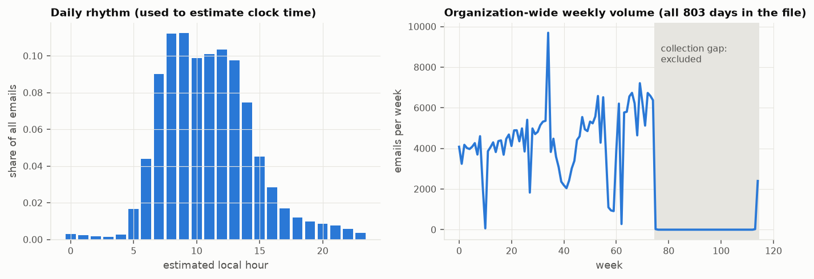
*Figure 1.1. Left: the daily rhythm used to estimate clock time. Right: weekly volume over the whole file; the shaded collection gap is excluded.*

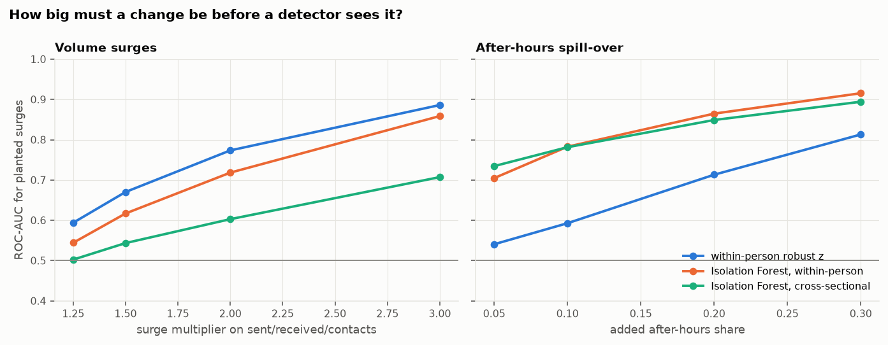
*Figure 1.2. ROC-AUC for planted surges, by detector and surge size.*

| Planted change | Robust z (within-person) | Isolation Forest, within | Isolation Forest, cross-sectional |
|---|---|---|---|
| Volume x1.25 | 0.59 | 0.54 | 0.50 |
| Volume x1.5 | 0.67 | 0.62 | 0.54 |
| Volume x2 | 0.77 | 0.72 | 0.60 |
| Volume x3 | **0.89** | 0.86 | 0.71 |
| After-hours +5 pts | 0.54 | 0.70 | 0.73 |
| After-hours +10 pts | 0.59 | 0.78 | 0.78 |
| After-hours +30 pts | 0.81 | **0.92** | 0.89 |

- **H1a is supported for volume.** Within-person baselines beat cross-sectional detection by 0.15-0.18 AUC for tripled load. For after-hours shifts, Isolation Forest beats the robust z, because most people's after-hours baseline is near zero.
- **H1b is supported.** A 25-50% load increase is close to undetectable (AUC 0.54-0.67).
- **The base rate decides precision.** Even when load triples, precision@k is only **17-18%**: of the top-flagged person-weeks, about 82% are natural fluctuations rather than planted surges. Some of those natural deviations are real surges, so this precision is a lower bound. Still, any person-level alert would be dominated by noise.
- **Real-data flags are unstable.** On real data, the three detectors' top-2% flags overlap only 26-35% (Jaccard). Only 10.8% of flagged person-weeks are flagged again the following week. Over 75 weeks, **51%** of all people were flagged at least once.
- **Team-level view.** With 35 inferred units and k = 5, the after-hours heatmap (Figure 1.3) shows unit-specific spill-over. 19.7% of unit-weeks are suppressed.
- **H1c is supported.** The workload index is constant across employees within each of 38 periods; it is organizational, not personal. Its period-level correlation with total absence hours is rho = -0.07 (p = 0.68); for "hit target", rho = 0.13 (p = 0.43). Grouped-CV AUC for long absences is 0.53-0.54 from work conditions. It reaches 0.61 only when personal and health-adjacent attributes (BMI, drinking, distance) are added, which an HR system should not use.

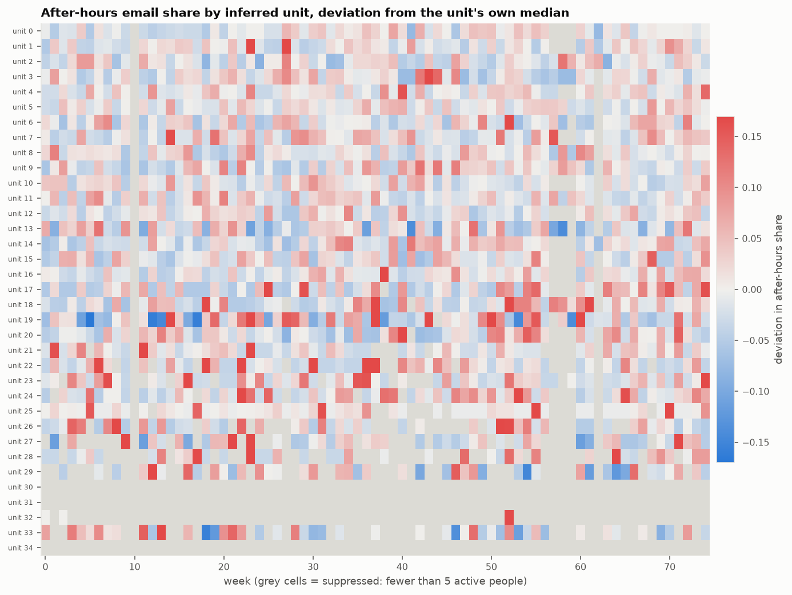
*Figure 1.3. After-hours email share by inferred unit, as deviation from each unit's own median. Grey cells are suppressed (fewer than 5 active people).*

**Which signals indicate pressure, and which cannot establish stress.**

| Can indicate increased work pressure, with caveats | Cannot establish psychological stress |
|---|---|
| Large sustained volume increases versus the team's own baseline | Any single person-week anomaly |
| Rising after-hours or weekend share at team level | Reply latency (it confounds availability, role and time zones) |
| Overtime concentration on few people | Raw email or meeting volume across people (role-driven) |
| Growing blocked-task time and re-opens (task data) | Login patterns, typing or mouse behaviour |

**Limitations.** One institution; email only. The clock is estimated. Planted surges are a proxy for real pressure episodes. The absenteeism data are small and organization-level.

**What success would demonstrate.** That large, sustained, team-level load changes are detectable from metadata. This held for large changes only.

---

### Experiment 2: Organizational collaboration graph analysis

| Item | Specification |
|---|---|
| Research questions | Can communication structure reconstruct the formal organization? Can graph metrics identify silos, brokerage bottlenecks and key-person dependency? Are such labels stable over time? |
| Hypotheses | H2a: communities align with departments well above chance. H2b: brokerage is highly concentrated. H2c: removing a few brokers disconnects far more coordination than removing random people. H2d: short-window centrality is unstable. |
| Data | email-Eu-core (1,005 people, 24,929 ties, 42 departments; 35 with 5 or more members); email-Eu-core-temporal for stability; SocioPatterns InVS15 for replication |
| Features | Degree, directed betweenness (exact, Brandes [23]), articulation points. Per department: internal-tie *lift* (observed internal share / share expected under a degree-preserving null), E-I index [22], partner departments, top-bridge share, people needed to carry 80% of external ties |
| Algorithms | Louvain (10 seeds, resolution sweep) [24]; label propagation; semi-supervised department inference (weighted neighbour vote; 48-dimensional spectral embedding plus logistic regression); targeted versus random node removal; centrality rank stability on 1-, 4- and 13-week snapshots |
| Metrics | NMI, ARI, modularity; accuracy and macro-F1; % cross-department ties lost and % department pairs disconnected; Spearman rho and top-5% retention |

**Results.**

- **Structure.** Density is 0.025, reciprocity 0.71, and 98.1% of people are in one component. Department assortativity is 0.30: people email inside their department far more than chance.
- **Concentration (H2b supported).** Betweenness Gini is **0.81**, degree Gini 0.54. The top 1% of people hold **20.0%** of all brokerage and the top 5% hold 49.0%. There are 73 articulation points. Degree and betweenness correlate at rho = 0.91, so "busy" and "broker" are hard to separate.
- **Community versus department (H2a supported, with caveats).** Default Louvain finds 7.4 communities: NMI 0.57 +/- 0.01, ARI 0.31. Across seeds, the partitions agree only at NMI 0.83, so community labels are not deterministic. The best resolution (4.0, chosen with the labels, so an optimistic bound) finds 49 communities: NMI 0.75, ARI 0.60. Label propagation collapsed into one community (NMI 0). On **face-to-face** data (SocioPatterns), Louvain matches departments much better: NMI 0.80, ARI 0.76.
- **Reconstruction (an attribute-inference risk).**

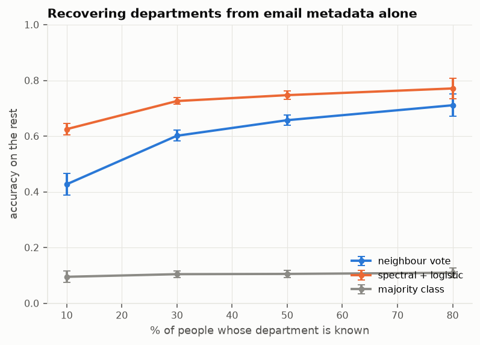
*Figure 2.1. Accuracy of recovering each person's department from email structure, by share of labels known.*

| Labels known | Spectral + logistic (email) | Neighbour vote (email) | Majority class | Neighbour vote (face-to-face) |
|---|---|---|---|---|
| 10% | **0.63** | 0.43 | 0.10 | 0.62 |
| 30% | 0.73 | 0.60 | 0.10 | 0.81 |
| 50% | 0.75 | 0.66 | 0.11 | 0.89 |
| 80% | 0.77 | 0.71 | 0.11 | - |

  The same property that makes the graph useful is a **privacy risk**. If 10% of department memberships are known, communication metadata reveals the rest with 63% accuracy across 35 classes. The same mechanism would work for any attribute correlated with who-talks-to-whom, such as union membership or health-related groups.

- **Silos and dependency.** The median department's internal-tie lift is 8.4. Flag rules are transparent and use quartiles. Departments D2, D24 and D3 are silo candidates (top-quartile inwardness and bottom-quartile reach). D2, D24 and D29 rely on **one person for at least 50%** of their cross-department ties. D31 has 8 members and **zero** internal ties, which suggests a virtual or administrative grouping and shows that org-chart units are not always teams. In the face-to-face data, every department met every other within 11.5 days, so no silo flags fired. The flag rules do not fire on structure that is merely clustered.

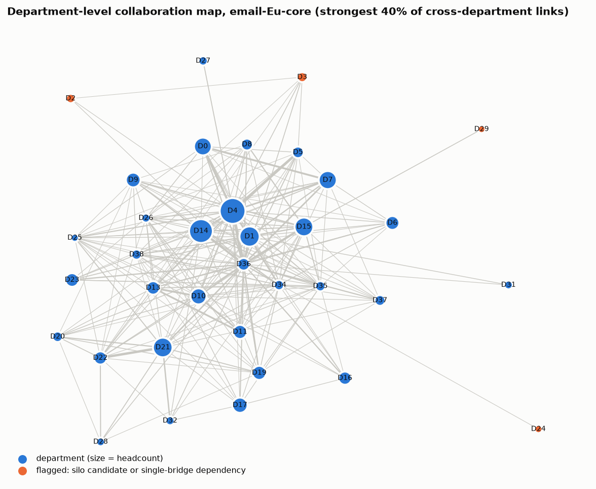
*Figure 2.2. Department-level collaboration map; flagged departments in orange.*

- **Key-person dependency (H2c supported).** Removing the 10 highest-brokerage people (1% of staff) removes **17.7%** of cross-department ties and leaves 1.7% of department pairs with no direct tie. Removing 10 random people removes 1.6% of ties. At 5% of staff: 51.6% versus 9.2% of ties, and 12.2% versus 2.0% of department pairs.

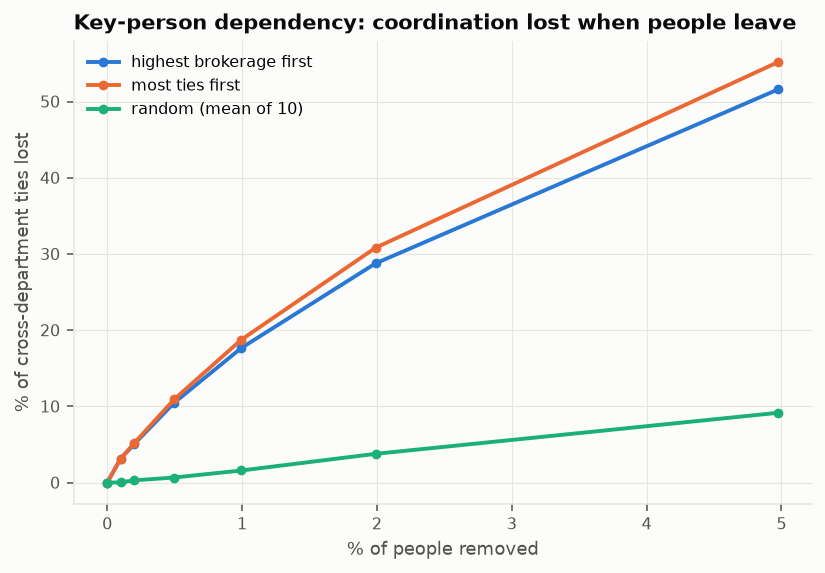
*Figure 2.3. Cross-department ties lost when people are removed: by brokerage, by number of ties, and at random.*

- **Stability (H2d supported).**

| Snapshot length | Degree rank rho | Betweenness rank rho | Top-5% brokers retained next period |
|---|---|---|---|
| 1 week | 0.65 | 0.58 | 49% |
| 4 weeks | 0.82 | 0.72 | 57% |
| 13 weeks | 0.90 | 0.80 | 61% |

  Bottleneck labels from weekly data are mostly noise. Even quarterly, about 40% of top brokers change. Any "bottleneck" output must be framed as a *role or position in a period*, never as a trait of a person.

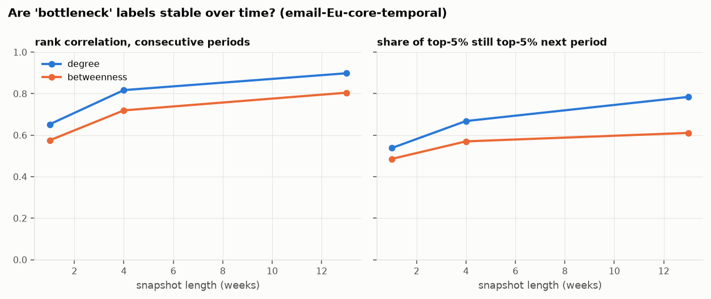
*Figure 2.4. Stability of degree and betweenness ranks between consecutive snapshots.*

**Limitations.** One email network and one face-to-face network. The email period is unknown and the network is static. Departments are the only label available; teams within departments are unknown.

**What success demonstrates.** That a metadata graph captures real organizational structure and can quantify silo and dependency risk. Both were demonstrated, with an attached privacy risk.

---

### Experiment 3: Skills and organizational capability analysis

| Item | Specification |
|---|---|
| Research questions | Can free-text work descriptions be mapped to the correct occupational skill profile? Can a team view expose gaps and single-holder skills without ranking people? Can aggregated AI usage be mapped to the same taxonomy? |
| Data | O\*NET 31.0: 914 occupations with 8 or more tasks; 14,425 training and 4,359 test task statements; 35 skills and 33 knowledge areas. Anthropic Economic Index. **Synthetic** member skill levels for the team demo |
| Method | Occupation profile = centroid of training-task embeddings. Test tasks, singly or in bags of 3-5 (simulating several work artifacts from one role), are mapped to the nearest centroid. Embeddings: TF-IDF (1-2-grams) versus `all-MiniLM-L6-v2` sentence embeddings [86]. Skill fidelity: compare the predicted occupation's skill-importance vector with the true occupation's |
| Metrics | Top-1/5/10 accuracy over 914 classes; skill-profile MAE (1-5 scale), Pearson r and top-5-skill Jaccard versus random-occupation and average-profile baselines |

**Results.**

| Artifacts per query | TF-IDF top-1 / top-5 | MiniLM top-1 / top-5 | MiniLM skill-profile MAE | MiniLM profile r | Top-5 skills Jaccard |
|---|---|---|---|---|---|
| 1 | 20.1% / 42.1% | 23.8% / 50.6% | 0.31 | 0.86 | 0.55 |
| 3 | 36.2% / 67.7% | 45.9% / 77.3% | 0.18 | 0.93 | 0.71 |
| 5 | 48.4% / 77.8% | **58.0% / 84.1%** | **0.13** | 0.95 | 0.79 |
| *baseline: random occupation* | 0.1% / 0.5% | - | 0.63 | 0.62 | - |
| *baseline: average profile* | - | - | 0.47 | - | - |

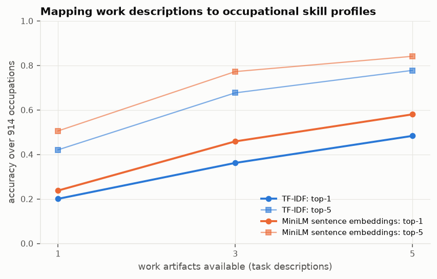
*Figure 3.1. Occupation-mapping accuracy by number of work artifacts and embedding method.*

- One artifact is not enough to infer a role. With five artifacts, the inferred **skill profile** is close to the truth (MAE 0.13), even when the exact occupation is wrong, because neighbouring occupations share skills. Sentence embeddings beat TF-IDF by 4-10 points.
- **Team capability (synthetic members, real requirements).** For a 12-person product team (7 O\*NET roles), 22 skills and knowledge areas are rated important (IM >= 3.5). Requirements are the highest level any role needs. With synthetic member levels, the coverage view shows 1 gap (Mathematics) and 3 single-holder areas. A departure what-if shows that if the project manager leaves, administrative knowledge becomes a gap. The output is a **team capability map**, not a ranking of people.

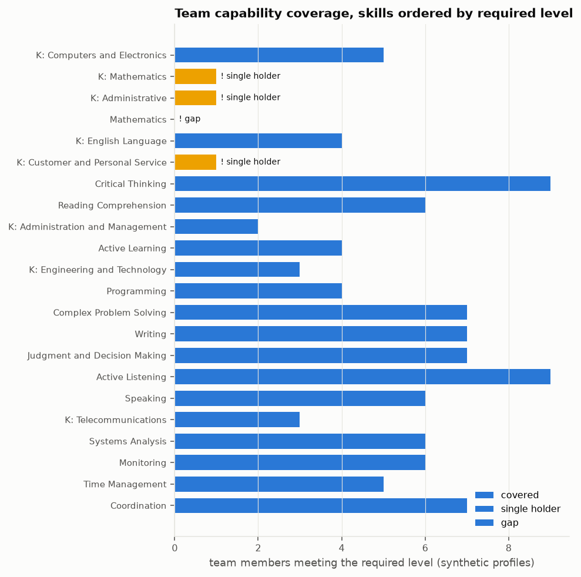
*Figure 3.2. Team members meeting each required level (synthetic profiles, real O\*NET requirements).*

- **AI usage mapped to tasks (real, aggregated).** 83.4% of Economic Index tasks match O\*NET 31.0 exactly. For the team's roles, the most AI-assisted tasks are debugging and code modification (QA analyst tasks: 5.5% of all conversations in the release) and web development (2.2%). Project-management tasks are almost absent (0.002%). This is the right shape for AI-interaction analytics: **task categories at population or team level**, never per person.

**Limitations.** O\*NET task statements are cleaner than real tickets or prompts, so expect lower accuracy on noisy enterprise text. Skill ratings are occupation-level. Self-declared skills are biased by confidence and gender, so verification and employee control are essential.

**What success demonstrates.** That skill-gap analysis can work from work descriptions at role and team level. This was demonstrated given several artifacts.

---

### Experiment 4: Work conditions and self-reported well-being

| Item | Specification |
|---|---|
| Research questions | (a) How strongly are demands, control, support and work-family conflict associated with self-reported stress, exhaustion and dissatisfaction? (b) How much of reported stress can **log-observable** variables predict, compared with **reported** work conditions? (c) Does demand-control-support replicate, including buffering? (d) Are relationships stable across 2002-2022? |
| Hypotheses | H4a: demands and work-family conflict carry the largest associations. H4b: observable hours predict reported stress only weakly. H4c: main effects replicate; buffering interactions are weak. H4d: the models transfer across waves. |
| Data | GSS QWL, six waves (n = 10,640 working respondents; 8,463 complete cases) |
| Outcomes | Work "always/often" stressful (30.8% weighted); felt "used up" very often/often (≈40%); not too / not at all satisfied (10.4%) |
| Predictors | *Observable-like:* hours last week, days with extra hours in the past month, email hours per week. *Reported demands:* too much work, must work fast, understaffed, conflicting demands. *Resources:* freedom to decide, schedule control, role clarity, respect, co-worker support, supervisor support. *Interface:* job interferes with family. Controls: age, sex, self-employment, survey year |
| Algorithms | Survey-weighted logistic GLM with robust (HC1) errors; nested model ladder with 5-fold x 3 repeated stratified CV (logistic and gradient boosting); train on waves up to 2014, test on 2018 and 2022; mean absolute SHAP [27] |

**Results.**

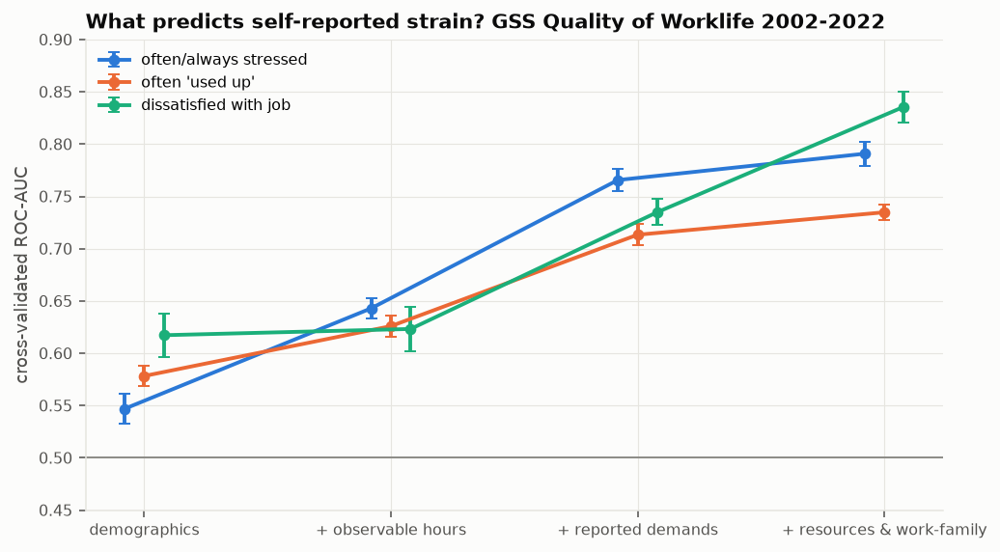
*Figure 4.1. Cross-validated ROC-AUC as predictor blocks are added, for three outcomes.*

| Model | Stress AUC | Exhaustion AUC | Dissatisfaction AUC |
|---|---|---|---|
| Demographics + year | 0.55 | 0.58 | 0.62 |
| + observable hours (hours, extra-hour days) | **0.64** | 0.63 | 0.62 |
| + reported demands | 0.77 | 0.71 | 0.74 |
| + resources and work-family | **0.79** | 0.74 | 0.84 |

- **H4b supported.** Hours-type signals, the closest analogue of what an HR system can log, give AUC 0.64 for reported stress. Adding **email hours** gives the same 0.643 (n = 4,716 in waves with the item). Reported conditions give 0.79-0.80. Gradient boosting matches logistic regression to within 0.01, so the gap is not a modelling limitation. The information is simply not in the logs.
- **H4d supported.** Trained on waves up to 2014, the full model achieves AUC 0.81 on 2018 and 0.80 on 2022. The hours-only model achieves 0.65 on both.
- **Group-level gradients are real even though individual prediction is weak.** This distinction is central to the product:

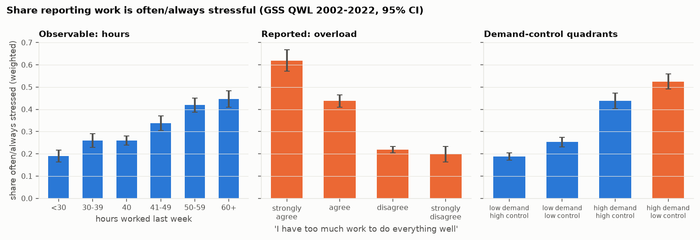
*Figure 4.2. Share reporting work as often or always stressful, by hours worked, reported overload and demand-control quadrant.*

| Group | % often/always stressed (weighted) |
|---|---|
| Worked under 30 h last week | 19.1% |
| 40 h | 26.0% |
| 50-59 h | 41.9% |
| 60 h or more | 44.6% |
| "Too much work": strongly disagree | 19.9% |
| "Too much work": strongly agree | **61.9%** |
| Low demand, high control | 18.8% |
| High demand, low control ("high strain") | **52.5%** |

  At team level, a drift toward long hours is a meaningful **risk indicator**. For a single person, it is close to a coin flip.

- **H4a supported.** Adjusted, survey-weighted odds ratios for frequent stress (full-scale change, 95% CI):

| Predictor | OR (95% CI) |
|---|---|
| Job interferes with family life | **5.01 (3.93-6.38)** |
| Job requires working very fast | 3.43 (2.55-4.62) |
| Too much work to do everything well | 2.73 (1.99-3.73) |
| Not enough staff | 2.36 (1.76-3.15) |
| Conflicting demands | 2.26 (1.72-2.96) |
| Extra-hour days (per 10 days/month) | 1.33 (1.21-1.47) |
| Hours worked (per 10 h/week) | 1.08 (1.02-1.14) |
| Treated with respect | **0.46 (0.31-0.69)** |
| Supervisor helpful | 0.56 (0.40-0.77) |
| Freedom to decide how to work | 0.87 (0.64-1.18), not significant once others are adjusted for |

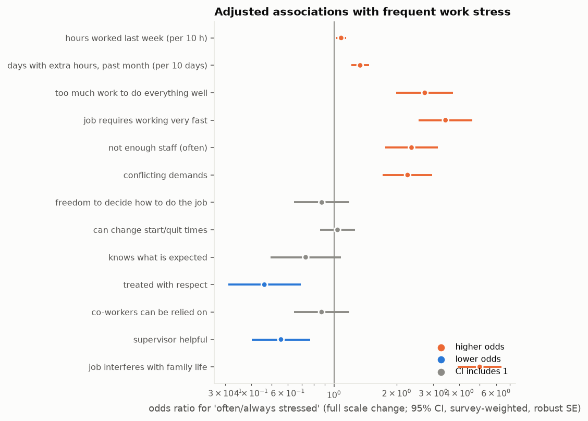
*Figure 4.3. Adjusted associations with frequent work stress (survey-weighted, robust SE).*

  The pattern for exhaustion is the same, with somewhat smaller ORs. Work-family interference has OR 3.14, respect 0.48 and supervisor support 0.68.

- **H4c supported.** Demand x control (OR 1.47, p = 0.48), demand x co-worker support (0.86, p = 0.80) and demand x supervisor support (2.44, p = 0.12) are not significant. Additive effects replicate; buffering does not, as previous reviews found [31, 89].
- **SHAP.** In mean |SHAP|, work-family interference (0.43) ranks first, followed by understaffing, overload, pace and conflicting demands (0.25-0.27). Extra-hour days (0.18) and weekly hours (0.10) rank lower.
- **Well-being and future performance.** These cannot be tested with public data. The GSS has no performance measure, and IBM's fictional data cannot be used (Section 5.4). **A prospective design is needed**:
  1. Voluntary quarterly COPSOQ III (short) or BAT, aggregated to teams of at least 5.
  2. Team-level operational outcomes such as flow metrics, quality incidents and customer measures, not individual ratings.
  3. Mixed-effects longitudinal models with team random effects and lagged predictors, pre-registered.

  Statistical power is the binding constraint. At **team** level, detecting a true correlation of r = 0.3 with 80% power needs **85 teams**; r = 0.2 needs 194; r = 0.1 needs 783 (`results/e4_wellbeing/power_table.csv`). Most single companies cannot reach this for small effects, so multi-employer research consortia or pooled benchmarks are needed.
- **If a synthetic dataset is required for demos,** generate it from a documented structural model whose parameters come from published estimates, such as the ORs above. Label it synthetic, and never use it to "discover" relationships, because it can only return what was put in.

**Limitations.** Single-item measures; cross-sectional associations (reverse causation is plausible: stressed people may *perceive* more overload); US data; common-method bias, since predictors and outcomes are self-reported together. That last point inflates the reported-conditions AUCs relative to the hours-only model.

**What success demonstrates.** That self-reported work conditions explain self-reported strain far better than log-like signals, and that group gradients exist. Both were demonstrated.

---

### Experiment 5: Early organizational risk prediction

| Item | Specification |
|---|---|
| Research questions | (a) How far ahead can team load and load spikes be forecast? (b) Can the collapse of an inter-team coordination channel be predicted from its structure? (c) Do channels carried by few people collapse sooner? |
| Hypotheses | H5a: forecast skill over naive baselines is small and decays with horizon. H5b: structural features beat volume-only models. H5c: fewer carriers means higher collapse hazard, adjusted for volume and unit size |
| Data | email-Eu-core-temporal, 75 dense weeks. 33 units inferred by Louvain **on the training weeks only** (no look-ahead). 507 unit pairs; 18 four-week windows. Temporal split: train before week 45 or window 10, test after |
| Targets | (a) log weekly unit load at h = 1, 2, 4, 8 weeks; spike = load at least 1.5x the trailing 8-week median. (b) Collapse = the channel's smoothed share of organization-wide email falls below 25% of its current smoothed share, h = 1-3 windows ahead (holiday-robust). (c) Time to first collapse |
| Features | Load lags 0-7, 4-week mean, slope, after-hours share, org load. For channels: log volume, trend, number of distinct people carrying the channel (bridges), top-bridge share, reciprocity, age, log unit-size product |
| Algorithms | Persistence, moving average, ridge, gradient boosting; logistic and gradient-boosting classifiers; Kaplan-Meier, log-rank test and Cox proportional hazards (lifelines [100]) |
| Metrics | MAE skill versus persistence; ROC-AUC and PR-AUC with base rate; hazard ratios and concordance |

**Results.**

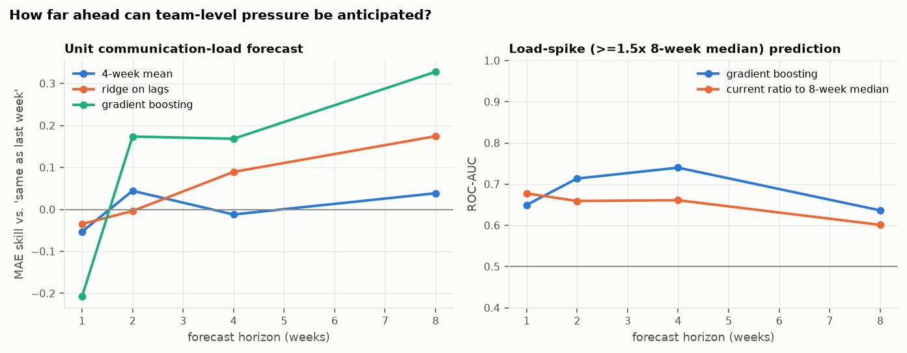
*Figure 5.1. Left: load-forecast skill versus "same as last week". Right: spike-prediction AUC by horizon.*

- **H5a supported.** Weekly unit load is very noisy: persistence MAE is 0.72-1.26 in log units, so errors are factors of 2-3.5. Gradient boosting is *worse* than persistence at 1 week (-21%) and better at 2-8 weeks (+17% to +33%), mostly by learning mean reversion. Spike prediction has AUC 0.65-0.74 (base rate 30-40%). A simple "current load / 8-week median" rule reaches 0.60-0.68.
- **H5b supported.** For coordination-channel collapse:

| Horizon | Volume only | Full structure (logistic) | Full structure (gradient boosting) | Base rate | PR-AUC (full, logistic) |
|---|---|---|---|---|---|
| 1 window (4 wks) | 0.65 | **0.70** | 0.66 | 5.9% | 0.10 |
| 2 windows | 0.66 | **0.75** | 0.68 | 8.9% | 0.20 |
| 3 windows | 0.65 | **0.76** | 0.70 | 9.5% | 0.25 |

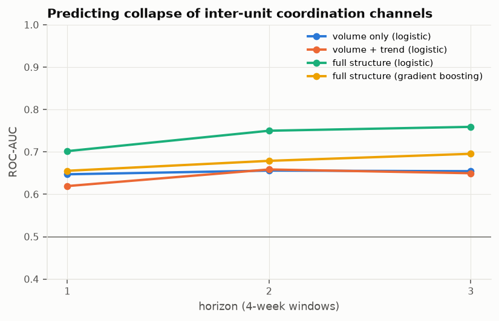
*Figure 5.2. ROC-AUC for predicting collapse of inter-unit coordination channels.*

- **H5c supported.** Of 321 channels, 176 collapsed during follow-up. Collapse rates were 82% for channels carried by 1-2 people (n = 38), 64% for 3-5 (n = 151) and **37% for 6 or more** (n = 132); log-rank p = 2.6e-11. In the Cox model, adjusted for volume, reciprocity, top-bridge share and unit size, the hazard ratio per log-unit of carriers is **0.31 (0.18-0.51)**: doubling the carriers multiplies the hazard by about 0.44. Volume itself is not significant once carriers are in the model (HR 0.99). Concordance is 0.70. This is real-data support for the "single specialist dependency" concern at team level.

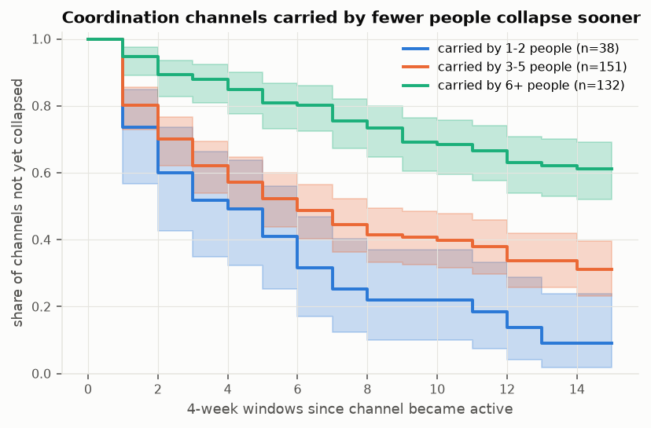
*Figure 5.3. Kaplan-Meier survival of coordination channels by number of carriers.*

**Limitations.** Inferred units, not real teams. Email only. "Collapse" is a communication pattern, not a verified coordination failure. Proportional hazards were not formally tested. One organization.

**What success demonstrates.** That team-level coordination risk is forecastable weeks ahead with moderate discrimination. Demonstrated, with low precision.

---

### Experiment 6: Multi-objective what-if simulation (synthetic)

| Item | Specification |
|---|---|
| Research question | How should decision support present trade-offs between output, workload sustainability, key-person dependency and cost, and how robust are rankings to unmeasured assumptions? |
| Model | **Synthetic.** 24 people in 4 teams, 26 weeks, 60 Monte Carlo runs with common random numbers. Gamma-distributed demand at 97% of capacity plus a 30% surge in weeks 8-15. 25% of output needs review by a single specialist. Handoff rework; overtime up to a policy cap; 2%/week absence plus an **assumed** absence feedback from long hours (beta) |
| Levers | Allocation (concentrated or balanced) x overtime cap (0/5/10/15 h) x hires (0-2) x cross-trained reviewers (0-2) x documentation (yes/no) x meeting cut (0/25%): 288 policies |
| Objectives | Output delivered; % person-weeks over 48 h (EU Working Time Directive average limit [82]); peak individual average hours; share of reviews by one person; % output lost if the specialist is absent 4 weeks; added headcount. **Kept separate; no single score** |
| Method | Full grid, Pareto filter (non-dominated on output, long hours, dependency, headcount), named options, sensitivity across four assumption sets, template-generated explanations (no LLM) |

**Results** (beta = 0.03; meetings cut without penalty):

| Option | Output (k work-hours) | Person-weeks over 48 h | Peak individual average | Reviews by one person | Output lost if specialist absent 4 wks |
|---|---|---|---|---|---|
| A. Push output (concentrated, 15 h overtime cap) | 18.11 | 47% | 54.7 h | 100% | 3.4% |
| B. Status quo (10 h cap) | 17.57 | 62% | 50.0 h | 100% | 3.3% |
| C. Balance load, 5 h cap | 16.55 | 0% | 45.0 h | 100% | 3.1% |
| D. C + cross-train 2 reviewers | 17.36 | 0% | 45.0 h | 37% | 0.7% |
| E. D + documentation + 25% fewer meetings | 18.30 | 0% | 44.7 h | 37% | 0.4% |
| F. E + 1 hire | 18.37 | 0% | 44.4 h | 37% | 0.2% |

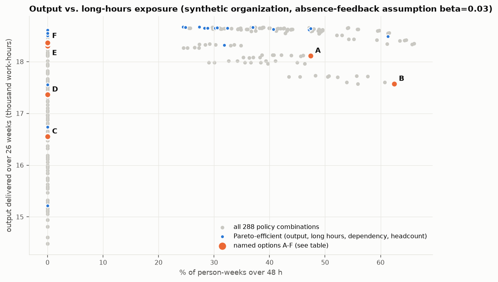
*Figure 6.1. Output versus long-hours exposure for all 288 policies; Pareto-efficient policies in blue, named options in orange.*

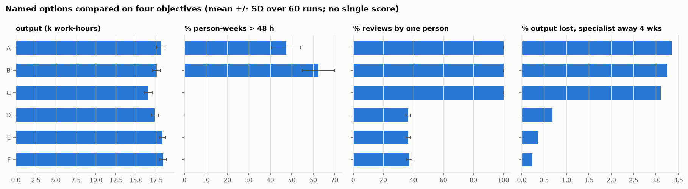
*Figure 6.2. Named options on four objectives (mean +/- SD over 60 runs).*

- **23 of 288** policies are Pareto-efficient. Option A has the "high output, high overtime" profile from the brief. Option D is "slightly lower output (-1.2% vs B), no one over 48 h, dependency cut from 100% to 37%, resilience loss cut from 3.3% to 0.7%".
- **Assumptions decide the headline.** E beats A on output only because we *assumed* that 25% of meeting time can be removed and converted to focus time. Without the meeting cut, the comparable policy delivers 17.55k, which is **3.1% less than A**. The ranking of the six named options is identical under all four assumption sets (Spearman 1.0). The margin between E and A, however, shrinks from +1.1% to +0.6% when fewer meetings are assumed to worsen handoffs.
- **The system explains, deterministically:**
  > *"D vs B: output -1.2%; person-weeks over 48 h 62.5% -> 0.0%; peak individual average 50.0 h -> 45.0 h; reviews done by one person 100% -> 37%; output lost if the specialist is away 4 weeks 3.3% -> 0.7%; added headcount 0 -> 0."*

  That sentence is generated by a template from simulator outputs. An LLM may rephrase it, but must not compute it.
- **No well-being claim is made.** The simulator models *hours*. E4 shows hours are associated with reported strain at group level. That justifies treating long-hours exposure as a sustainability objective. It does not justify predicting a well-being improvement.

**What success demonstrates.** That trade-offs can be made explicit and assumption-tested. The simulator is a communication tool, not a forecast.

---

### Experiment 7: Organizational graph schema and team profiles (synthetic)

Described in Section 7. It builds a 68-node example graph (24 employees, 24 tasks, 3 projects, 8 skills, 5 knowledge resources, 4 teams) and generates team profiles with provenance and caveats.

---

## 7. Graph architecture and organizational modeling

### 7.1 Proposed schema (labelled property graph, time-stamped edges)

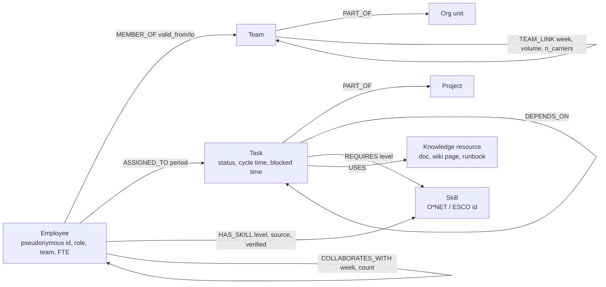

Design rules:

1. **Two tiers.** A restricted person-tier graph is used only for computation inside the analytics enclave. The team-tier graph (TEAM_LINK and team aggregates) is the only one exposed to dashboards.
2. **Every edge has a period** (`valid_from`, `valid_to` or ISO week) and an **evidence source**. Temporal queries such as "dependencies that appeared this quarter" are first-class.
3. **No content.** Collaboration edges hold counts and timings only.
4. **Skills carry provenance:** self-declared, manager-confirmed, certified or inferred. Inferred skills are visible to and editable by the employee before use.

The schema is also exported as `results/e7_graph_schema/schema.json`.

### 7.2 Example instance

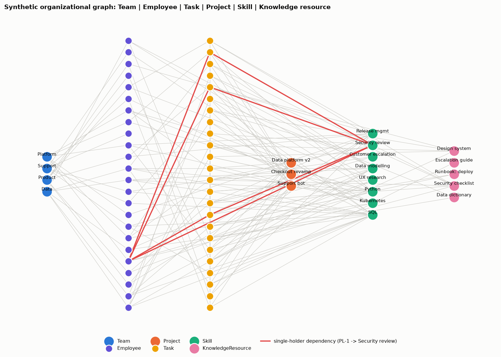
*Figure 7.1. Synthetic example graph. The red path shows that three Checkout tasks require "Security review", which only one person holds. This is a dependency query, not a judgement about that person.*

Example path from the brief, as a Cypher-style query:

```cypher
MATCH (a:Employee)-[:ASSIGNED_TO]->(t:Task)-[:PART_OF]->(p:Project),
      (t)-[:DEPENDS_ON]->(t2:Task)<-[:ASSIGNED_TO]-(b:Employee)-[:MEMBER_OF]->(team:Team),
      (t2)-[:USES]->(r:KnowledgeResource)
RETURN team.name, p.name, count(DISTINCT t2) AS upstream_dependencies, collect(DISTINCT r.name) AS resources
```

### 7.3 Analytics catalog and methods

| Question | Graph method | Evidence from experiments |
|---|---|---|
| Which teams are inward-looking (silo candidates)? | Internal-tie lift against a degree-preserving null; partner reach | E2: lift and reach flags; no false flags in face-to-face data |
| Where is coordination concentrated? | Betweenness Gini; share of cross-team ties carried by the top person; people needed for 80% of external ties | E2: top 1% carry 20% of brokerage |
| Which dependencies hang on one person? | Bridge count per TEAM_LINK; articulation points; skill single-holder query | E5: fewer carriers, higher collapse hazard (HR 0.31 per log-unit) |
| What breaks if someone leaves? | Targeted node removal on the person tier, reported as % channels lost | E2: 1% of brokers carry 17.7% of cross-department ties |
| Which skills are missing or fragile? | REQUIRES versus HAS_SKILL coverage | E3 |
| How is structure changing? | Windowed metrics (4-13 weeks); community tracking | E2: weekly windows too noisy |
| Learned representations | GNNs (PyTorch Geometric [102]) for link prediction | Optional; spectral embeddings already reach 73-77% on department inference. GNNs add opacity for little gain at this scale |

### 7.4 Explainable team-level profiles

Profiles describe **work conditions and structure**, with provenance, caveats and an explicit list of what is absent. Excerpt from `results/e7_graph_schema/team_profiles.json`:

```json
{
  "team": "Platform",
  "period": "2026-W30..W39 (synthetic)",
  "headcount": 6,
  "work": {"tasks_in_period": 8, "blocked_tasks": 1},
  "coordination": {"cross_team_dependencies": 2, "external_share_of_collaboration": 0.468},
  "capability": {"single_holder_skills": ["Security review"], "unheld_skills": []},
  "provenance": ["HRIS membership", "task tracker (assignment, status, dependency)",
                 "collaboration metadata aggregated weekly, no content"],
  "caveats": ["describes work structure, not individual performance",
              "collaboration volume is not a measure of value or quality"],
  "deliberately_absent": ["individual scores or rankings", "inferred stress, mood or health", "message content"]
}
```

A **role-level** profile, such as "release coordinator", is defined the same way for roles held by at least k people. For a role held by one person, the profile *is* that person and is therefore suppressed from HR views.

---

## 8. Well-being measurement feasibility

### 8.1 Instruments

| Instrument | Construct | Items | Licensing (verify before commercial use) | Fit for HR Nexus |
|---|---|---|---|---|
| **COPSOQ III** [35] | Broad psychosocial work environment: demands, influence, support, recognition, justice, work-life conflict, burnout, stress | Core/middle/long versions | Free to use under the COPSOQ International Network guidelines; the network describes a CC BY-NC-ND 4.0 licence and also permits fees for analysis services. **The commercial terms are ambiguous; confirm with the network** | **Best primary instrument.** Designed for workplace risk assessment and benchmarking |
| **Copenhagen Burnout Inventory** [33] | Personal, work-related and client-related burnout | 19 | Freely available from the developers (NFA, Denmark) | Good for burnout-risk *trend* at team level |
| **Burnout Assessment Tool (BAT)** [38] | Exhaustion, mental distance, cognitive and emotional impairment | 23 (12 short) | Free for non-commercial use; commercial use needs permission | Modern alternative to the MBI |
| Maslach Burnout Inventory | Burnout | 22 | **Proprietary** (Mind Garden), per-use fees | Costly; avoid for an MVP |
| **Perceived Stress Scale** [34] | General (not work-specific) perceived stress | 10 (PSS-10) | Free for academic and non-profit use; commercial use needs permission (Mapi ePROVIDE) [105] | Use only as an optional, general measure |
| **NASA-TLX** [36] | Task-specific workload: mental, physical, temporal, performance, effort, frustration | 6 | Public domain (NASA) | Workload of a **specific task or sprint**, not chronic stress. Good for evaluating process changes |
| **Edmondson psychological safety** [37] | Team psychological safety | 7 | Published scale; check copyright for commercial products | Key team-level construct |
| Job Content Questionnaire / ERI [29, 99] | Demand-control / effort-reward | 27+ / 23 | JCQ licensed (fee); ERI free for non-commercial research | Research-grade alternatives |
| WHO-5, PHQ-9, GAD-7 | Mental-health screening | 5-9 | Free | **Clinical screening, not for HR use** |

### 8.2 Occupational assessment versus clinical assessment

- **Occupational psychosocial risk assessment** asks about **work conditions and their effects** in groups, to fix the work. It is grounded in the employer's legal duty to assess all risks, including psychosocial ones, under EU Framework Directive 89/391/EEC [83] and national transpositions. COPSOQ was built for this.
- **Clinical assessment** asks whether a person has a disorder. It requires clinicians, consent and confidentiality, and belongs to occupational health, never HR analytics.
- HR Nexus may report *"Team X: work-life conflict scale up 12 points since Q2 (n = 14 respondents, 70% response rate)"*. It must never report *"Employee Y shows burnout risk"*.

### 8.3 Survey design requirements

1. **Voluntary and confidential.** Use a separate survey processor. HR never sees responses at individual level, and results are reported only for groups of at least 5 respondents (at least 10 is preferable for subgroup cuts).
2. **Guard against differencing attacks.** Do not allow overlapping cuts whose difference isolates fewer than k people. Use a query auditor, or add differential-privacy noise to published aggregates [61].
3. **Response-rate gating.** Do not show a team result below about 50-60% response; non-response is informative.
4. **Lawful basis.** Prefer legal obligation (risk assessment) or legitimate interest, with anonymity by design. Employee **consent** is generally not freely given in employment [74, 104].
5. **Joins.** Join survey aggregates to metadata aggregates only at team level. Never link individual survey responses to individual activity data.

### 8.4 What cannot be inferred, and why

| Claim | Status | Evidence |
|---|---|---|
| Stress from login times, email volume or hours | **Not at individual level** | E4: AUC 0.64; group gradients only |
| Stress or emotion from typing, mouse, face or voice | **Lab effects only; poor generalization; EU-prohibited in the workplace when based on biometric data** | [40-44]; AI Act Art. 5(1)(f) [71, 73] |
| Burnout from prompts or chat text | **Unvalidated**; construct-validity problems | [46]; prompts reflect the task, not the person |
| Knowledge gaps from aggregated AI questions | **Plausible at topic and team level** | Clio/EI-style aggregation [9, 10]; E3 task mapping |

### 8.5 AI-interaction analytics: what is defensible

- **Measurable, aggregated:** volume per team-week; task category from a classifier (E3 shows the taxonomy mapping works at aggregate level); share of sessions with three or more reformulations; clusters of recurring unresolved questions (minimum cluster size of 10 or more users).
- **Plausible uses:** missing documentation (recurring questions about internal system X), training demand (high reformulation on topic Y), tooling friction.
- **Not defensible:** individual competence scores from prompts, "struggling employee" alerts, or reading prompts.
- **Unproven:** that prompt reformulation measures friction rather than exploratory use. The search literature suggests it [47], but it needs validation against user-reported satisfaction.
- **Required safeguards:**
  - classify on-device or inside a privacy enclave, and drop raw text after classification;
  - publish the topic taxonomy to employees;
  - give employees an opt-out, or private sessions that are never analyzed.

Without these, employees will route around the company AI, which defeats its purpose.

---

## 9. Predictive modeling feasibility

| Target | Level | Achieved here | Realistic horizon | Notes |
|---|---|---|---|---|
| Team communication-load level | Team | Skill over persistence -21% (1 wk) to +33% (8 wk); errors x2-3.5 | 2-8 weeks for trend; not week-level | Calendar effects dominate; needs at least 2 years for seasonality |
| Team load spike (1.5x median) | Team | AUC 0.65-0.74 | 2-4 weeks | Base rate 30-40%; simple ratio rules nearly as good |
| Coordination-channel collapse | Team pair | AUC 0.70-0.76; PR-AUC 0.10-0.25 | 1-3 months | Use as watch-list ranking, not alerts |
| Channel survival by number of carriers | Team pair | HR 0.31 per log-unit of carriers; C = 0.70 | Months | Most actionable: add redundancy |
| Reported team stress from conditions | Team (survey) | AUC 0.79-0.81 from reported conditions | Next survey wave | Requires surveys; cross-sectional |
| Reported stress from hours only | Individual | AUC 0.64 | n/a | **Not suitable** for individual decisions |
| Individual attrition | Individual | Not attempted | n/a | Excluded: high-risk, invites pre-emptive discrimination |

**Correlation, prediction, causation.**

- Experiments 4 and 5 establish *associations* (E4) and *predictability* (E5).
- Neither establishes that changing the predictor changes the outcome. That needs interventions with designs: staggered roll-outs (difference-in-differences), randomized pilots of meeting-free days or cross-training, or target-trial emulation [58].
- Experiment 6 is a *model of assumptions*, not causal evidence.

---

## 10. Multi-objective HR decision support

**Principles, demonstrated in E6:**

1. Keep the objectives separate: output; workload sustainability (long-hours exposure, peak load); key-person dependency; resilience; capability; cost. When people-reported well-being is available, show it as **its own axis** from surveys, never derived from metadata.
2. Show the **Pareto set** and a handful of named options. Never show a single "optimal" recommendation, because weights between output and well-being are value judgements that belong to HR, management and employee representatives.
3. Make **assumptions visible and adjustable** (beta, meeting-cut penalty), and show whether rankings survive them.
4. Generate **explanations deterministically** from model outputs (template text). An LLM may only rephrase them, with numbers locked.
5. **Hard constraints** come from law and policy (for example, no person-week over 48 h on average under the Working Time Directive), not from optimization.
6. The system **never** decides promotion, dismissal, discipline or individual ranking. Consequential decisions need a named human approver, recorded in the audit log.

For larger decision spaces than our 288-policy grid, use NSGA-II [56] via pymoo [57] with the same objective definitions. For staffing optimization, use mixed-integer programming with explicit fairness constraints.

---

## 11. Security and privacy threat model

**Assets.** Person-tier metadata, survey responses, skills profiles, the organizational graph, models and embeddings, the LLM layer (prompts, RAG index), audit logs.

| # | Threat (STRIDE plus ML) | Actor | Example | Mitigations |
|---|---|---|---|---|
| T1 | **Function creep and misuse** | Employer or management | Using bottleneck or overload views to pick redundancies, or to monitor a union organizer | Purpose binding in policy *and* code (no person-level API); works-council agreement; DPIA; audit of every query; employee-visible transparency report |
| T2 | **Re-identification from aggregates** | Curious manager | Differencing two team cuts; a team of 6 minus one known person | k >= 5 (prefer 10 for survey cuts); overlap-query auditor; DP noise on published aggregates [61]; no free-form slicing |
| T3 | **Attribute inference from structure** | Analyst or insider | E2: department recovered with 63-77% accuracy from the graph; also possible for health or union groups | Person-tier graph only inside the enclave; team-tier graph only outside; no export of edges; pseudonym rotation |
| T4 | **De-anonymization of the graph** | External attacker with partial knowledge | Structural attacks on anonymized social graphs [62, 63] | Encrypt at rest; never release person-tier graphs; contracts banning re-identification |
| T5 | Unauthorized access / elevation | External or insider | Stolen HR credentials | SSO + MFA; RBAC and ABAC (OPA); just-in-time access; separate keys per tier (KMS/HSM); tamper-evident audit log |
| T6 | **Prompt injection** (direct or indirect) | Any user, or poisoned documents in RAG | A wiki page instructs the assistant to list "employees with most after-hours activity" [64, 65] | The LLM gets no data tool beyond **approved parameterized queries** that return team-level aggregates; output filters; RAG over vetted policy corpora only; tool allow-lists |
| T7 | Sensitive data leakage via LLM | LLM provider or model | Prompts containing personal data retained by a vendor; memorization [67] | Zero-retention enterprise endpoint or self-hosted model; never fine-tune on employee data; PII scrubbing |
| T8 | **Data poisoning and gaming** | Employees or teams | Inflating tickets or meetings to look busy; coordinated survey answers | Metrics are not used for individual evaluation (removes the incentive); robust statistics; anomaly checks on input distributions [66] |
| T9 | Model and analytic error | System | Holiday collapse read as a team crisis (E1); unstable broker labels (E2) | Calendar models; window of 4 weeks or more; uncertainty shown; human review of every flag before action |
| T10 | Retention overreach | Operator | Raw metadata kept for years | Raw person-tier events kept for at most 30-90 days, then only aggregates (CNIL found 31 days of granular indicators excessive in the Amazon case [79]); retention jobs with deletion proofs |
| T11 | Chilling effects (harm without breach) | The system itself | People avoid the company AI, Slack or documents | Publish what is and is not measured; employee access to their own data (GDPR Art. 15); private AI sessions |

**Privacy-first architecture.**

- **Pseudonymize at ingestion** with keyed hashing; the key is held by a separate custodian.
- **Compute person-level features only inside an enclave.** Only k-anonymous team aggregates leave it.
- **Restrict survey data.** It lives in a separate tenant and joins metadata only at team level.
- **Bound the LLM.** It sees aggregates and policy documents only.
- **Log everything.** Every read is logged and reviewable by the DPO and the works council.

---

## 12. Legal and regulatory considerations

*This is not legal advice. Analysis is current to 31 October 2026 and EU-centred. Check national labour law: works councils, unions, and local data-protection authorities.*

### 12.1 GDPR [70]

- **Lawful basis (Art. 6).** Consent is rarely valid for employees because of the power imbalance [74, 104]. Use legitimate interest with a documented balancing test, or legal obligation for occupational-safety risk assessment [83].
- **Special categories (Art. 9).** Identifiable well-being or stress data is **health data**. Keep surveys anonymous by design and process them in a separate controller or processor setup.
- **Data minimization and purpose limitation (Art. 5).** Use metadata, not content. Aggregate early and delete raw data quickly.
- **Transparency (Arts. 13-14).** Tell employees what is collected, why, and what is never inferred.
- **Profiling and automated decisions (Art. 22).** No solely automated decisions with legal or similarly significant effects. Human review must be meaningful.
- **DPIA (Art. 35).** Required: systematic monitoring of employees meets several of the WP248 high-risk criteria [75].
- **Employment context (Art. 88).** National rules apply. After CJEU C-34/21 [77], national employee-data rules must meet Art. 88(2) to stand alone, so the general GDPR bases govern. Germany and France additionally require works-council or CSE involvement for monitoring-capable technology.
- **Case law and enforcement.**
  - *Bărbulescu v. Romania* [78]: monitoring requires prior notice, proportionality and safeguards.
  - **CNIL fined Amazon France Logistique €32 million** (decision of 27 December 2023) for scanner-based inactivity and speed indicators and excessive retention [79].
  - The Hamburg DPA fined **H&M €35.3 million** (October 2020) for employee profiling [80].

### 12.2 EU AI Act [71], as amended by the Digital Omnibus on AI [72]

- **Prohibited practice, Art. 5(1)(f).** AI systems that **infer emotions of a natural person in the workplace** are prohibited except for medical or safety reasons. This has applied since **2 February 2025**. "Emotion recognition" is defined by reference to **biometric data** (Art. 3(39)). Recital 18 excludes purely physical states such as fatigue or pain. Whether inferred "stress" counts as an emotion is an interpretation question; the Commission's guidelines on prohibited practices [73] are the reference. **Design rule: no stress, mood or emotion inference from face, voice, keystrokes or physiology, full stop.**
- **High-risk, Annex III point 4(b).** This covers AI intended to make decisions affecting work relationships, promotion or termination, to **allocate tasks based on individual behaviour or personal traits**, or to **monitor and evaluate the performance and behaviour** of workers. Under Art. 6(3), an Annex III system that **profiles natural persons is always high-risk**.
  - A team-level process-analytics tool that does not evaluate individuals can plausibly sit outside Annex III. Any feature that scores, ranks or flags individuals brings it inside.
  - Under the Digital Omnibus (Regulation (EU) 2026/1744, in force 27 July 2026), Annex III obligations apply from **2 December 2027**.
  - Deployer duties include human oversight, logging, and **informing workers' representatives and affected workers before use (Art. 26(7))**. Art. 86 adds a right to explanation.
- **Other provisions.**
  - **AI literacy (Art. 4)** was softened by the Omnibus to a duty to take measures.
  - **Transparency (Art. 50):** HR users must know they are interacting with an AI assistant.
  - **Bias detection (Art. 4a):** the Omnibus adds a legal basis to process special-category data for bias detection under conditions. This is relevant if fairness audits are run.

### 12.3 Other instruments

- **Platform Work Directive (EU) 2024/2831** [81] bans processing of emotional or psychological states by platforms' algorithmic management. It does not directly apply to ordinary employers, but it signals the direction of travel.
- **Working Time Directive 2003/88/EC** [82]: the 48-hour average limit is a hard constraint, used in E6.
- **United States:** state laws are fragmented (Illinois BIPA for biometrics, NYC Local Law 144 for automated employment decisions, Colorado's AI Act, California's CCPA covering employee data). Check current effective dates.
- **Elsewhere:** apply the local data-protection law, such as Tunisia's Organic Law 2004-63, Brazil's LGPD or the UK GDPR. Equivalents of DPIAs and consultation duties typically apply.

### 12.4 Work-process analysis versus individual evaluation

| Analyzes work processes (lower risk) | Evaluates individuals (high-risk or prohibited) |
|---|---|
| Team cycle time, blocked work, dependency maps | Individual productivity or "collaboration" scores |
| Team after-hours trend (k >= 5) | Person-level after-hours alerts |
| Single-holder **skills** and fragile **channels** | Ranking "critical" or "replaceable" people |
| Aggregated survey results | Individual stress or burnout risk |
| Aggregated AI-usage topics | Prompt review or competence inference |

---

## 13. Proposed system architecture

### 13.1 Comparison

| Architecture | Strengths | Weaknesses | Verdict |
|---|---|---|---|
| Conventional ML/analytics pipeline | Deterministic, testable, auditable; cheap | Rigid; poor natural-language access | **Core of the system** |
| LLM agent architecture (agent with tools over raw data) | Flexible Q&A; fast demos | Non-deterministic numbers; prompt injection; hard to audit; tempts privacy breaches (the agent can query anything) | **Reject as the core** |
| **Hybrid** (deterministic analytics, plus an LLM limited to explanation, RAG and approved query templates) | Reliable numbers, natural-language UX, traceable | More engineering | **Recommended** |

### 13.2 Division of labour

| Layer | Do with | Never do with |
|---|---|---|
| Ingestion, normalization, pseudonymization, k-suppression, retention | Deterministic code with tests | ML or LLM |
| Workload, flow and calendar metrics | Deterministic code plus robust statistics | LLM |
| Anomaly and trend detection | Statistical models (robust z, Isolation Forest, seasonal decomposition) | LLM |
| Graph metrics, communities, bridges | Graph algorithms (NetworkX/igraph; graph database for storage) | LLM |
| Survey scoring and team-level models | Validated scoring keys; mixed-effects models | LLM |
| Forecasts and survival | Statistical and ML models with backtests | LLM |
| Scenario simulation and Pareto | Simulation plus optimization | LLM |
| Explanation of results | Templates first; an LLM may paraphrase with numbers locked and citations to metric IDs | Free LLM generation of numbers |
| Policy Q&A | RAG over vetted HR policies with citations | Ungrounded LLM answers |
| Question to analysis | LLM selects from **approved, parameterized, team-level query templates** | Free-form SQL or Cypher generation over person-level data |

### 13.3 Data flow

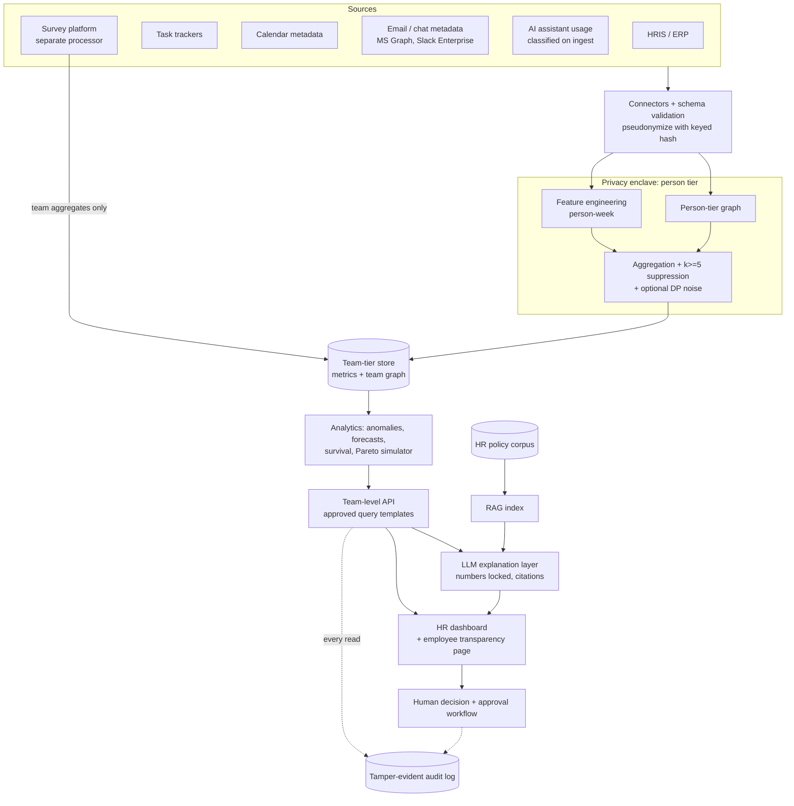

---

## 14. Technology stack

| Concern | Choice (Python-centred) | Notes |
|---|---|---|
| Connectors | Microsoft Graph API (mail and calendar metadata, Teams activity), Slack Enterprise Grid Audit/Discovery API, Google Workspace Reports API, Jira/Azure DevOps REST, HRIS APIs (Workday, SAP SuccessFactors, BambooHR) | Request metadata scopes only; admin consent; document scopes in the DPIA. Consider ingesting *already aggregated* Viva Insights exports where available |
| Orchestration and transformation | Dagster or Airflow; dbt; DuckDB/Polars for batch | |
| Storage | PostgreSQL (+ pgvector), object storage with encryption; graph: PostgreSQL + Apache AGE or Neo4j for the team tier; NetworkX/igraph for batch | |
| Data quality | pandera / Great Expectations | Catches problems like the 38-week gap in email-Eu-core |
| Analytics and ML | pandas, NumPy, SciPy, scikit-learn, statsmodels, lifelines, SHAP (all used here); PyTorch Geometric optional | Pinned in `requirements.txt` |
| Optimization and simulation | NumPy simulation (E6); pymoo (NSGA-II); OR-Tools for staffing MIP | |
| Text and skills | sentence-transformers (MiniLM or a multilingual model), O\*NET/ESCO taxonomies | |
| Privacy | Keyed hashing (HMAC) with a separate key custodian; OpenDP / Google DP library for noisy aggregates | |
| Access control | Entra ID / Keycloak SSO + MFA; Open Policy Agent for ABAC; Vault or cloud KMS | |
| LLM layer | Enterprise endpoint with zero data retention, or self-hosted open-weight model; RAG with citations; approved-template tool calls only | Use the latest Claude model via an enterprise agreement, or a self-hosted model if data must stay on-premises |
| API and UI | FastAPI; React or Streamlit for MVP; Plotly or Vega-Lite charts | |
| MLOps and audit | MLflow; append-only audit store (WORM bucket or ledger table); model cards and datasheets | NIST AI RMF [68] and ISO/IEC 42001 [103] as governance frameworks |

---

## 15. Implementation roadmap

**Phase 0: hackathon MVP (48-72 h).** Use the public datasets in this repository as the demo back-end.

1. Team-level dashboard. Department collaboration map, silo and single-bridge flags (E2), after-hours heatmap with suppression (E1), channel-survival watch list (E5).
2. Skills coverage view (E3) and the scenario explorer with Pareto chart and template explanations (E6).
3. "What we do not measure" panel and a sample DPIA outline.
4. LLM assistant that answers *"why is department D24 flagged?"* by citing precomputed metrics, plus policy RAG.

**Phase 1: pilot (3 months, one consenting business unit of 150 people or more).**

- DPIA; works-council or CSE agreement; employee information sessions; transparency page.
- Connectors: HRIS + task tracker + calendar metadata. Email and chat metadata only if the pilot needs it.
- Quarterly COPSOQ III short survey through a separate processor.
- Pre-registered evaluation: do HR and team leads find flags actionable? What are the false-positive rates on reviewed flags? Do employees trust the system (survey)?

**Phase 2: product (6-12 months).**

- Enclave architecture, DP aggregates, audit tooling, model cards.
- Prospective well-being and performance study across at least 85 teams (multi-employer if needed).
- Randomized or staggered intervention pilots (meeting-free days, cross-training) to obtain **causal** effect estimates that can replace E6's assumptions.
- Prepare for Annex III obligations (December 2027) if any individual-level feature is ever considered. The recommendation is not to build any.

---

## 16. Limitations and unresolved research questions

**Limitations of this study.**

1. Real organizational data came from **one email network** (unknown period, research institution) and **one face-to-face network** (11.5 days). External validity to companies with Teams/Slack-heavy work is untested.
2. **No ground truth** for workload pressure or coordination failure. We used planted surges and channel-collapse proxies.
3. The GSS analysis is **cross-sectional, single-item and self-report on both sides**. That inflates associations through common-method variance.
4. Skills mapping was evaluated on clean O\*NET statements, not noisy tickets or prompts.
5. E6 is synthetic. Its parameters are illustrative, not estimated.
6. We did not run SWELL-KW (registration-gated). A direct replication of "computer activity to stress" on that dataset is the most valuable next experiment for Section 8.4.

**Open research questions.**

- Does a team-level coordination-risk watch list reduce actual delivery failures when acted on? This needs an intervention study.
- What k and differential-privacy budget keep graph aggregates useful while defeating differencing and structural attacks in realistic org sizes of 20-500?
- Can AI-assistant reformulation rates be validated as a friction measure against user-reported satisfaction?
- How do metadata indicators behave in hybrid and asynchronous organizations, where Teams chat replaces email?
- What is the causal effect of reducing single-carrier channels (cross-training, rotation) on resilience and on carriers' own workload?
- How should multi-objective trade-offs be governed? Who sets the weights, and how are employee representatives involved?

---

## 17. Final feasibility verdict

| Dimension | Score /100 | Justification |
|---|---|---|
| Scientific feasibility | **55** | Structure and coordination analytics are well-founded (E2, E5). Stress or emotion inference from activity is not (E4, [40-46]). Well-being-to-performance links are unproven at individual level |
| Data availability | **35** | No public dataset combines metadata, validated well-being and performance. Inside companies, metadata exists, but legal and consultation friction is substantial |
| Technical feasibility | **75** | Everything here runs on standard Python in minutes. Connectors and enclave engineering are the real work |
| Predictive reliability | **35** | Team-level AUC 0.65-0.76 with PR-AUC 0.10-0.25; weekly load errors x2-3. Individual prediction is not reliable |
| Graph intelligence potential | **70** | Department recovery 73-89%, brokerage concentration, a carriers-to-hazard effect with HR 0.31. It is also a privacy hazard |
| HR usefulness | **60** | Silos, dependency, overload trends and skills gaps are actionable *if* framed at team level and paired with surveys |
| Security and privacy feasibility | **50** | Achievable with an enclave, k-thresholds, DP and LLM tool restrictions. Inference risk is inherent (E2) and function creep is the dominant threat |
| Implementation complexity (higher = harder) | **70** | Many connectors, governance processes, works-council negotiation and audit tooling |
| Hackathon MVP feasibility | **80** | A credible demo on public data exists in this repository |
| Long-term commercial potential | **50** | Real demand, but a crowded market (Viva Insights, Visier, Culture Amp and others) and high trust requirements. Differentiation must come from governance and decision-support quality |

### Answers to the twelve questions

**1. Can this system genuinely reconstruct how teams work together from organizational data?**
Partly, and better than intuition suggests for *structure*. Email metadata recovered formal departments with 73% accuracy from 30% of labels (chance 10%); face-to-face contacts reached 81-89%. Louvain communities matched departments at NMI 0.57-0.80. It does **not** reconstruct the *quality*, content or purpose of collaboration, and short-window snapshots are unstable.

**2. Which organizational problems can it reliably detect?**
At team level:

- silo candidates (inward-looking units with low reach);
- concentration of brokerage (top 1% hold 20%);
- single-person dependencies in cross-team channels and skills;
- large, sustained load or after-hours increases relative to the team's own baseline;
- capability gaps against role requirements.

It cannot reliably detect modest surges, individual overload, or why a problem exists.

**3. Can it predict workload pressure and coordination failures?**
Modestly. Team load spikes: AUC 0.65-0.74 at 2-4 weeks. Coordination-channel collapse: AUC 0.70-0.76 at 1-3 months, with low precision. Use these outputs as ranked watch lists for human review, not as alerts.

**4. Can it scientifically estimate stress or burnout, and under what conditions?**
Only through **validated, voluntary self-report instruments** (COPSOQ, CBI, BAT), aggregated to groups of at least 5 with adequate response rates. Work conditions then explain group strain well (AUC about 0.8 from reported conditions in the GSS). Hours-type metadata give only AUC 0.64 for an individual's reported stress, which is useful as a team-trend risk indicator and unacceptable for individuals.

**5. Can it measure individual emotional states from digital activity? What evidence supports or contradicts this?**
No. Supporting evidence is limited to small laboratory studies with induced stressors [41, 42]. Contradicting evidence includes:

- poor cross-study generalization of passive-sensing models [43, 44];
- the unreliability of expression-to-emotion inference [40];
- construct-validity problems [46];
- our own finding that even rich *hours* data barely predict reported stress.

It is also **prohibited** in EU workplaces when based on biometric data (AI Act Art. 5(1)(f)).

**6. Can it understand relationships between employee well-being and future performance?**
Not from public data, and only with difficulty in any single company. A prospective, pre-registered, team-level longitudinal design with at least 85 teams is needed to detect r = 0.3 (Section 6, E4). The literature suggests moderate satisfaction-performance correlations [51] and weak burnout-objective-performance links [52], and none of it licenses individual prediction.

**7. How can it represent the company through dynamic graphs?**
As a time-stamped labelled property graph with two tiers: person-tier inside a privacy enclave, team-tier for dashboards. It links Employee, Team, Task, Project, Skill and KnowledgeResource, every edge carries a period and an evidence source, and analytics use windows of at least 4 weeks (Section 7).

**8. Which datasets can actually support these experiments?**
SNAP email-Eu-core and its temporal version, SocioPatterns InVS15, the GSS Quality of Worklife module, O\*NET 31.0 and the Anthropic Economic Index (all used). Registration-gated next steps: EWCS/EWCTS for an EU well-being replication, SWELL-KW for activity-to-stress, and public Jira data for task-dependency work. Synthetic sets such as IBM HR and HackerEarth are only for software testing.

**9. What is scientifically unproven or technically unrealistic?**

- Individual stress, burnout or emotion detection from metadata, prompts or typing.
- Individual performance prediction from well-being.
- Weekly-precision "bottleneck people" lists.
- Causal claims from observational dashboards.
- An LLM agent that safely reasons over raw employee data.

**10. What is the smallest credible prototype?**
A team-level dashboard on public data (Phase 0) with four panels: collaboration map with silo and single-bridge flags; channel-survival watch list; after-hours trend with k-suppression; skills coverage. Add a scenario explorer with Pareto chart and template explanations, plus an LLM explainer restricted to precomputed metrics and policy RAG. In a company: HRIS + task tracker + calendar metadata + one COPSOQ short survey, for one business unit.

**11. What should be excluded from the initial product?**

- Individual scores and rankings of any kind.
- Emotion, stress or mood inference.
- Keystroke, mouse, screen or webcam data.
- Message or prompt content.
- Individual attrition prediction.
- Automated personnel decisions.
- Covert collection.
- Financial-risk or health inferences.
- Free-form LLM querying of person-level data.

**12. What would make this approach genuinely different from existing HR analytics platforms?**
Analytics alone will not differentiate; Viva Insights and others already compute collaboration metrics. Four things together could:

- **coordination-risk** analytics (channel fragility, single-carrier dependencies, survival watch lists) rather than activity volume;
- **validated psychosocial surveys** joined only at team level, with work conditions as the explanatory variables, not employees' traits;
- **multi-objective scenario support** that shows Pareto trade-offs and assumption sensitivity instead of one "optimal" answer;
- **symmetric transparency**: employees see the same team-level views and the list of what is never measured, backed by an auditable enclave architecture designed for EU AI Act and GDPR compliance from day one.

Whether buyers pay for restraint is a market question that this research cannot settle.

**Bottom line.** HR Nexus can become a scientifically defensible, technically implementable, privacy-preserving **team-level** workforce-intelligence and decision-support platform. It cannot become a defensible system for measuring individual employees' psychological states. The research supports building the former and explicitly ruling out the latter.

---

## Reproducibility

```bash
python -m venv .venv && .venv\Scripts\activate        # Windows (source .venv/bin/activate elsewhere)
pip install -r requirements.txt
python scripts/download_data.py                        # writes data/raw/MANIFEST.json with SHA-256 hashes
python scripts/run_all.py                              # ~5-8 min on a laptop CPU
```

- Seed `20261031` everywhere. Python 3.11.9; package versions pinned in `requirements.txt`.
- Outputs: `results/e*/metrics.json` (all numbers above), CSV tables, `figures/*.png`.
- Data licences: see Section 4.1. Raw data is not committed (`.gitignore`); the manifest is.

---

## References

Dates are publication dates; URLs were checked or retrieved on 31 October 2026 where marked "accessed".

**Datasets and data documentation**

1. Leskovec J., Kleinberg J., Faloutsos C. (2007). Graph evolution: densification and shrinking diameters. *ACM TKDD* 1(1). https://doi.org/10.1145/1217299.1217301. Dataset: https://snap.stanford.edu/data/email-Eu-core.html (accessed 2026-10-31)
2. Yin H., Benson A. R., Leskovec J., Gleich D. F. (2017). Local higher-order graph clustering. *KDD 2017*. https://doi.org/10.1145/3097983.3098069
3. Paranjape A., Benson A. R., Leskovec J. (2017). Motifs in temporal networks. *WSDM 2017*. https://doi.org/10.1145/3018661.3018731. Dataset: https://snap.stanford.edu/data/email-Eu-core-temporal.html
4. Génois M. et al. (2015). Data on face-to-face contacts in an office building suggest a low-cost vaccination strategy based on community linkers. *Network Science* 3(3):326-347. https://doi.org/10.1017/nws.2015.10. Dataset: https://sociopatterns.org/datasets/contacts-in-a-workplace/
5. Génois M., Barrat A. (2018). Can co-location be used as a proxy for face-to-face contacts? *EPJ Data Science* 7:11. https://doi.org/10.1140/epjds/s13688-018-0140-1
6. Martiniano A., Ferreira R., Sassi R., Affonso C. (2012). Application of a neuro fuzzy network in prediction of absenteeism at work. *CISTI 2012*. UCI dataset (2018): https://doi.org/10.24432/C5X882
7. NORC at the University of Chicago. General Social Survey 1972-2024, Quality of Worklife module (NIOSH). https://gss.norc.org/ ; https://www.cdc.gov/niosh/stress/worklife-question/index.html (accessed 2026-10-31)
8. National Center for O\*NET Development (August 2026). O\*NET 31.0 Database, CC BY 4.0. https://www.onetcenter.org/database.html
9. Handa K. et al. (2025). Which economic tasks are performed with AI? Evidence from millions of Claude conversations. arXiv:2503.04761. Dataset: https://huggingface.co/datasets/Anthropic/EconomicIndex (release 2025-02-10)
10. Tamkin A. et al. (2024). Clio: privacy-preserving insights into real-world AI use. arXiv:2412.13678
11. IBM (2018). employee-attrition-aif360 (fictional IBM HR Analytics data). https://github.com/IBM/employee-attrition-aif360

**Organizational networks and sensing**

12. Yang L. et al. (2022). The effects of remote work on collaboration among information workers. *Nature Human Behaviour* 6:43-54 (online 9 Sep 2021). https://doi.org/10.1038/s41562-021-01196-4
13. Aral S., Brynjolfsson E., Van Alstyne M. (2012). Information, technology, and information worker productivity. *Information Systems Research* 23(3-2):849-867. https://doi.org/10.1287/isre.1110.0408
14. Michalski R., Palus S., Kazienko P. (2011). Matching organizational structure and social network extracted from email communication. *BIS 2011*, LNBIP 87:197-206. https://doi.org/10.1007/978-3-642-21863-7_17
15. Kossinets G., Watts D. J. (2006). Empirical analysis of an evolving social network. *Science* 311(5757):88-90. https://doi.org/10.1126/science.1116869
16. Kim T., McFee E., Olguín D. O., Waber B., Pentland A. (2012). Sociometric badges: using sensor technology to capture new forms of collaboration. *Journal of Organizational Behavior* 33(3):412-427. https://doi.org/10.1002/job.1776
17. Bernstein E. S., Turban S. (2018). The impact of the "open" workspace on human collaboration. *Phil. Trans. R. Soc. B* 373:20170239. https://doi.org/10.1098/rstb.2017.0239
18. Cross R., Rebele R., Grant A. (2016). Collaborative overload. *Harvard Business Review*, Jan-Feb 2016. https://hbr.org/2016/01/collaborative-overload
19. Leonardi P., Contractor N. (2018). Better people analytics. *Harvard Business Review*, Nov-Dec 2018. https://hbr.org/2018/11/better-people-analytics
20. Tursunbayeva A., Di Lauro S., Pagliari C. (2018). People analytics: a scoping review of conceptual boundaries and value propositions. *International Journal of Information Management* 43:224-247. https://doi.org/10.1016/j.ijinfomgt.2018.08.002
21. Burt R. S. (2004). Structural holes and good ideas. *American Journal of Sociology* 110(2):349-399. https://doi.org/10.1086/421787
22. Krackhardt D., Stern R. N. (1988). Informal networks and organizational crises: an experimental simulation. *Social Psychology Quarterly* 51(2):123-140. https://doi.org/10.2307/2786835
23. Brandes U. (2001). A faster algorithm for betweenness centrality. *Journal of Mathematical Sociology* 25(2):163-177. https://doi.org/10.1080/0022250X.2001.9990249
24. Blondel V. D. et al. (2008). Fast unfolding of communities in large networks. *J. Stat. Mech.* P10008. https://doi.org/10.1088/1742-5468/2008/10/P10008
25. Traag V. A., Waltman L., van Eck N. J. (2019). From Louvain to Leiden: guaranteeing well-connected communities. *Scientific Reports* 9:5233. https://doi.org/10.1038/s41598-019-41695-z
26. Liu F. T., Ting K. M., Zhou Z.-H. (2008). Isolation forest. *ICDM 2008*. https://doi.org/10.1109/ICDM.2008.17
27. Lundberg S., Lee S.-I. (2017). A unified approach to interpreting model predictions. *NeurIPS 2017*. arXiv:1705.07874
28. Goh K.-I., Barabási A.-L. (2008). Burstiness and memory in complex systems. *EPL* 81:48002. https://doi.org/10.1209/0295-5075/81/48002

**Work stress, well-being and performance**

29. Karasek R. A. (1979). Job demands, job decision latitude, and mental strain. *Administrative Science Quarterly* 24(2):285-308. https://doi.org/10.2307/2392498
30. Johnson J. V., Hall E. M. (1988). Job strain, work place social support, and cardiovascular disease. *American Journal of Public Health* 78(10):1336-1342. https://doi.org/10.2105/AJPH.78.10.1336
31. Häusser J. A., Mojzisch A., Niesel M., Schulz-Hardt S. (2010). Ten years on: a review of recent research on the Job Demand-Control(-Support) model and psychological well-being. *Work & Stress* 24(1):1-35. https://doi.org/10.1080/02678371003683747
32. Bakker A. B., Demerouti E. (2007). The Job Demands-Resources model: state of the art. *Journal of Managerial Psychology* 22(3):309-328. https://doi.org/10.1108/02683940710733115
33. Kristensen T. S., Borritz M., Villadsen E., Christensen K. B. (2005). The Copenhagen Burnout Inventory. *Work & Stress* 19(3):192-207. https://doi.org/10.1080/02678370500297720
34. Cohen S., Kamarck T., Mermelstein R. (1983). A global measure of perceived stress. *Journal of Health and Social Behavior* 24(4):385-396. https://doi.org/10.2307/2136404
35. Burr H. et al. (2019). The third version of the Copenhagen Psychosocial Questionnaire. *Safety and Health at Work* 10(4):482-503. https://doi.org/10.1016/j.shaw.2019.10.002. Use guidelines: https://www.copsoq-network.org/guidelines (accessed 2026-10-31)
36. Hart S. G., Staveland L. E. (1988). Development of NASA-TLX. In *Human Mental Workload*, Advances in Psychology 52:139-183. https://doi.org/10.1016/S0166-4115(08)62386-9
37. Edmondson A. (1999). Psychological safety and learning behavior in work teams. *Administrative Science Quarterly* 44(2):350-383. https://doi.org/10.2307/2666999
38. Schaufeli W. B., Desart S., De Witte H. (2020). Burnout Assessment Tool (BAT): development, validity, and reliability. *IJERPH* 17(24):9495. https://doi.org/10.3390/ijerph17249495
39. World Health Organization (28 May 2019). Burn-out an "occupational phenomenon": International Classification of Diseases. https://www.who.int/news/item/28-05-2019-burn-out-an-occupational-phenomenon-international-classification-of-diseases
40. Barrett L. F. et al. (2019). Emotional expressions reconsidered. *Psychological Science in the Public Interest* 20(1):1-68. https://doi.org/10.1177/1529100619832930
41. Koldijk S. et al. (2014). The SWELL knowledge work dataset for stress and user modeling research. *ICMI 2014*. https://doi.org/10.1145/2663204.2663257
42. Koldijk S., Neerincx M. A., Kraaij W. (2018). Detecting work stress in offices by combining unobtrusive sensors. *IEEE Transactions on Affective Computing* 9(2):227-239. https://doi.org/10.1109/TAFFC.2016.2610975
43. Adler D. A. et al. (2022). Machine learning for passive mental health symptom prediction: generalization across different longitudinal mobile sensing studies. *PLOS ONE* 17(4):e0266516. https://doi.org/10.1371/journal.pone.0266516
44. Xu X. et al. (2022). GLOBEM dataset: multi-year datasets for longitudinal human behavior modeling generalization. *NeurIPS 2022 Datasets and Benchmarks*. arXiv:2211.02733
45. Mattingly S. M. et al. (2019). The Tesserae project: large-scale, longitudinal, in situ, multimodal sensing of information workers. *CHI EA 2019*. https://doi.org/10.1145/3290607.3299041
46. Chancellor S., De Choudhury M. (2020). Methods in predictive techniques for mental health status on social media: a critical review. *npj Digital Medicine* 3:43. https://doi.org/10.1038/s41746-020-0233-7
47. Hassan A., Shi X., Craswell N., Ramsey B. (2013). Beyond clicks: query reformulation as a predictor of search satisfaction. *CIKM 2013*. https://doi.org/10.1145/2505515.2505682
48. Brynjolfsson E., Li D., Raymond L. (2025). Generative AI at work. *Quarterly Journal of Economics* 140(2):889-942. https://doi.org/10.1093/qje/qjae044
49. Pega F. et al. (2021). Global, regional, and national burdens of ischemic heart disease and stroke attributable to exposure to long working hours. *Environment International* 154:106595. https://doi.org/10.1016/j.envint.2021.106595
50. Pencavel J. (2015). The productivity of working hours. *Economic Journal* 125(589):2052-2076. https://doi.org/10.1111/ecoj.12166
51. Judge T. A., Thoresen C. J., Bono J. E., Patton G. K. (2001). The job satisfaction-job performance relationship. *Psychological Bulletin* 127(3):376-407. https://doi.org/10.1037/0033-2909.127.3.376
52. Taris T. W. (2006). Is there a relationship between burnout and objective performance? A critical review of 16 studies. *Work & Stress* 20(4):316-334. https://doi.org/10.1080/02678370601065893
53. Harter J. K., Schmidt F. L., Hayes T. L. (2002). Business-unit-level relationship between employee satisfaction, employee engagement, and business outcomes. *Journal of Applied Psychology* 87(2):268-279. https://doi.org/10.1037/0021-9010.87.2.268
54. Frazier M. L. et al. (2017). Psychological safety: a meta-analytic review and extension. *Personnel Psychology* 70(1):113-165. https://doi.org/10.1111/peps.12183

**Simulation, optimization and causal inference**

55. Levitt R. E. et al. (1999). Simulating project work processes and organizations: toward a micro-contingency theory of organizational design. *Management Science* 45(11):1479-1495. https://doi.org/10.1287/mnsc.45.11.1479
56. Deb K., Pratap A., Agarwal S., Meyarivan T. (2002). A fast and elitist multiobjective genetic algorithm: NSGA-II. *IEEE Transactions on Evolutionary Computation* 6(2):182-197. https://doi.org/10.1109/4235.996017
57. Blank J., Deb K. (2020). pymoo: multi-objective optimization in Python. *IEEE Access* 8:89497-89509. https://doi.org/10.1109/ACCESS.2020.2990567
58. Hernán M. A., Robins J. M. (2020). *Causal Inference: What If*. Chapman & Hall/CRC. https://miguelhernan.org/whatifbook
59. Little J. D. C. (1961). A proof for the queuing formula L = λW. *Operations Research* 9(3):383-387. https://doi.org/10.1287/opre.9.3.383

**Privacy, security and AI risk**

60. Sweeney L. (2002). k-anonymity: a model for protecting privacy. *IJUFKS* 10(5):557-570. https://doi.org/10.1142/S0218488502001648
61. Dwork C., McSherry F., Nissim K., Smith A. (2006). Calibrating noise to sensitivity in private data analysis. *TCC 2006*. https://doi.org/10.1007/11681878_14
62. Backstrom L., Dwork C., Kleinberg J. (2007). Wherefore art thou r3579x? Anonymized social networks, hidden patterns, and structural steganography. *WWW 2007*. https://doi.org/10.1145/1242572.1242598
63. Narayanan A., Shmatikov V. (2009). De-anonymizing social networks. *IEEE S&P 2009*. https://doi.org/10.1109/SP.2009.22
64. Greshake K. et al. (2023). Not what you've signed up for: compromising real-world LLM-integrated applications with indirect prompt injection. *AISec 2023*. https://doi.org/10.1145/3605764.3623985
65. OWASP (18 Nov 2024). OWASP Top 10 for LLM Applications 2025. https://genai.owasp.org/llm-top-10/
66. Carlini N. et al. (2024). Poisoning web-scale training datasets is practical. *IEEE S&P 2024*. arXiv:2302.10149
67. Carlini N. et al. (2021). Extracting training data from large language models. *USENIX Security 2021*. arXiv:2012.07805
68. NIST (26 Jan 2023). AI Risk Management Framework 1.0 (NIST AI 100-1). https://doi.org/10.6028/NIST.AI.100-1
69. NIST (26 Jul 2024). AI RMF: Generative AI Profile (NIST AI 600-1). https://doi.org/10.6028/NIST.AI.600-1

**Law, regulation and enforcement**

70. Regulation (EU) 2016/679 (General Data Protection Regulation), 27 Apr 2016. https://eur-lex.europa.eu/eli/reg/2016/679/oj
71. Regulation (EU) 2024/1689 (Artificial Intelligence Act), 13 Jun 2024; OJ 12 Jul 2024. https://eur-lex.europa.eu/eli/reg/2024/1689/oj
72. Regulation (EU) 2026/1744 (Digital Omnibus on AI), 8 Jul 2026; OJ 24 Jul 2026; in force 27 Jul 2026. CELEX 32026R1744. Secondary summaries: https://www.euaiact.com/digital-omnibus-ai ; https://cdp.cooley.com/digital-ai-omnibus-delays-key-deadlines-introduces-new-rules/ (accessed 2026-10-31; verify article-level details on EUR-Lex)
73. European Commission (4 Feb 2025). Guidelines on prohibited artificial intelligence practices under the AI Act, C(2025) 884. https://digital-strategy.ec.europa.eu/en/library/commission-publishes-guidelines-prohibited-artificial-intelligence-ai-practices-defined-ai-act
74. Article 29 Working Party (8 Jun 2017). Opinion 2/2017 on data processing at work (WP249). https://ec.europa.eu/newsroom/article29/items/610169
75. Article 29 Working Party (4 Oct 2017). Guidelines on Data Protection Impact Assessment (WP248 rev.01). https://ec.europa.eu/newsroom/article29/items/611236
76. Article 29 Working Party (10 Apr 2014). Opinion 05/2014 on Anonymisation Techniques (WP216). https://ec.europa.eu/justice/article-29/documentation/opinion-recommendation/files/2014/wp216_en.pdf
77. CJEU, Case C-34/21 *Hauptpersonalrat der Lehrerinnen und Lehrer*, 30 Mar 2023, ECLI:EU:C:2023:270. https://curia.europa.eu/juris/liste.jsf?num=C-34/21
78. ECtHR (Grand Chamber), *Bărbulescu v. Romania*, no. 61496/08, 5 Sep 2017. https://hudoc.echr.coe.int/eng?i=001-177082
79. CNIL (decision 27 Dec 2023, published Jan 2024). Employee monitoring: CNIL fined Amazon France Logistique €32 million. https://www.cnil.fr/en/employee-monitoring-cnil-fined-amazon-france-logistique-eu32-million
80. EDPB national news (Oct 2020). Hamburg Commissioner fines H&M 35.3 million euro for data protection violations in service centre. https://edpb.europa.eu/news/national-news/2020/hamburg-commissioner-fines-hm-353-million-euro-data-protection-violations-service_en
81. Directive (EU) 2024/2831 on improving working conditions in platform work, 23 Oct 2024. https://eur-lex.europa.eu/eli/dir/2024/2831/oj
82. Directive 2003/88/EC concerning certain aspects of the organisation of working time, 4 Nov 2003. https://eur-lex.europa.eu/eli/dir/2003/88/oj
83. Council Directive 89/391/EEC (OSH Framework Directive), 12 Jun 1989. https://eur-lex.europa.eu/eli/dir/1989/391/oj
104. EDPB (4 May 2020). Guidelines 05/2020 on consent under Regulation 2016/679. https://www.edpb.europa.eu/our-work-tools/our-documents/guidelines/guidelines-052020-consent-under-regulation-2016679_en
107. CJEU, Case C-55/18 *CCOO v Deutsche Bank SAE*, 14 May 2019, ECLI:EU:C:2019:402 (obligation to record daily working time). https://curia.europa.eu/juris/liste.jsf?num=C-55/18

**Industry documentation**

84. Microsoft Learn. Customize Viva Insights privacy settings; Privacy considerations for Viva Insights. https://learn.microsoft.com/en-us/viva/insights/advanced/setup-maint/privacy-settings ; https://learn.microsoft.com/en-us/viva/insights/privacy/privacy-considerations (accessed 2026-10-31)
85. Spataro J. (1 Dec 2020). Our commitment to privacy in Microsoft Productivity Score. Microsoft 365 Blog. https://www.microsoft.com/en-us/microsoft-365/blog/2020/12/01/our-commitment-to-privacy-in-microsoft-productivity-score/
105. Carnegie Mellon University, Laboratory for the Study of Stress, Immunity, and Disease. Perceived Stress Scale: permissions. https://www.cmu.edu/common-cold-project/measures-by-study/psychological-and-social-constructs/stress-measures/perceived-stress.html (accessed 2026-10-31)

**Skills, text and AI usage**

86. Reimers N., Gurevych I. (2019). Sentence-BERT. *EMNLP-IJCNLP 2019*. https://doi.org/10.18653/v1/D19-1410
87. Zhang M., Jensen K. N., Sonniks S. D., Plank B. (2022). SkillSpan: hard and soft skill extraction from English job postings. *NAACL 2022*. https://doi.org/10.18653/v1/2022.naacl-main.366
88. Mark G., Gudith D., Klocke U. (2008). The cost of interrupted work: more speed and stress. *CHI 2008*. https://doi.org/10.1145/1357054.1357072

**Additional work-stress and dataset references**

89. Van der Doef M., Maes S. (1999). The Job Demand-Control(-Support) model and psychological well-being: a review of 20 years of empirical research. *Work & Stress* 13(2):87-114. https://doi.org/10.1080/026783799296084
90. Klimt B., Yang Y. (2004). The Enron corpus: a new dataset for email classification research. *ECML 2004*. https://doi.org/10.1007/978-3-540-30115-8_22
91. Sapiezynski P., Stopczynski A., Lassen D. D., Lehmann S. (2019). Interaction data from the Copenhagen Networks Study. *Scientific Data* 6:315. https://doi.org/10.1038/s41597-019-0325-x
92. Montgomery L., Lüders C., Maalej W. (2022). An alternative issue tracking dataset of public Jira repositories. *MSR 2022*. https://doi.org/10.1145/3524842.3528486
93. Zhao W. et al. (2024). WildChat: 1M ChatGPT interaction logs in the wild. *ICLR 2024*. arXiv:2405.01470
94. Zheng L. et al. (2024). LMSYS-Chat-1M: a large-scale real-world LLM conversation dataset. *ICLR 2024*. arXiv:2309.11998
95. Open Sourcing Mental Illness (2014-2016). OSMI Mental Health in Tech Survey. https://www.kaggle.com/datasets/osmi/mental-health-in-tech-survey
96. Eurofound. European Working Conditions Surveys. https://www.eurofound.europa.eu/en/surveys/european-working-conditions-surveys
97. Avelino G., Passos L., Hora A., Valente M. T. (2016). A novel approach for estimating truck factors. *ICPC 2016*. https://doi.org/10.1109/ICPC.2016.7503718
98. Ajunwa I., Crawford K., Schultz J. (2017). Limitless worker surveillance. *California Law Review* 105(3):735-776.
99. Siegrist J. (1996). Adverse health effects of high-effort/low-reward conditions. *Journal of Occupational Health Psychology* 1(1):27-41. https://doi.org/10.1037/1076-8998.1.1.27
100. Davidson-Pilon C. (2019). lifelines: survival analysis in Python. *JOSS* 4(40):1317. https://doi.org/10.21105/joss.01317
101. Software: Hagberg A., Schult D., Swart P. (2008). NetworkX, *SciPy 2008*; Pedregosa F. et al. (2011). scikit-learn, *JMLR* 12:2825-2830; Seabold S., Perktold J. (2010). statsmodels, *SciPy 2010*.
102. Fey M., Lenssen J. E. (2019). Fast graph representation learning with PyTorch Geometric. arXiv:1903.02428
103. ISO/IEC 42001:2023. Information technology: artificial intelligence management system. https://www.iso.org/standard/81230.html
106. Wang R. et al. (2014). StudentLife: assessing mental health, academic performance and behavioral trends of college students using smartphones. *UbiComp 2014*. https://doi.org/10.1145/2632048.2632054
