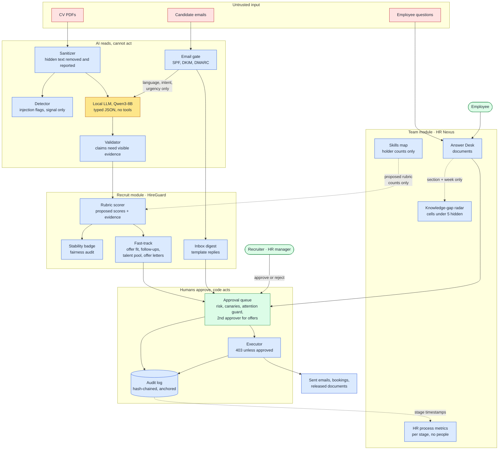
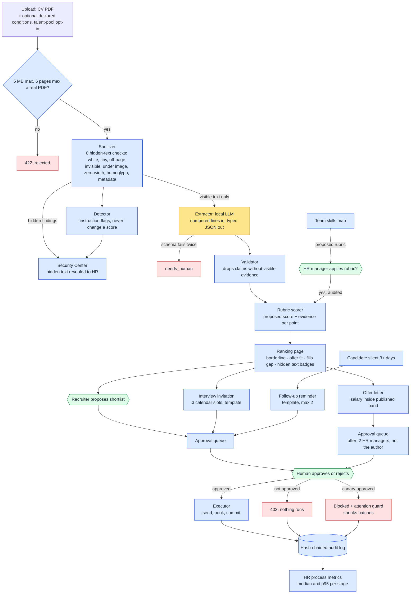

# Platform architecture: one trust core, two modules

Owner: Ahmed (system design). Reviewers: Rayen (backend), Yasmina (frontend), Hedhili (model).

> **The AI reads, code decides, humans approve.**
> Whatever reads stranger text cannot act; whatever can act never reads stranger text.

The brief asks for an AI agent that takes over an HR team's daily work, with one golden rule: *the agent executes, the human decides about people*. We ship one product with two modules on a shared trust core:

- **HireGuard: Recruit** (HR and candidates).
- **HR Nexus: Team** (HR and staff).

## 1. System context

Colours: red = untrusted input, yellow = the only place a model runs, blue = deterministic code, green = people. Dotted arrows are the only cross-module flows, all aggregate.

**External services:**

- **Ollama** (Qwen3-8B) on the customer's own machine by default (`HG_OLLAMA_HOSTS=http://localhost:11434`). Optional: a Modal cloud GPU behind proxy auth (`infra/`, used for the hackathon with fictional data only) and a Groq fallback (off by default, fictional data only). Production for a Tunisian customer stays on-premise.
- **Mail:** a mock outbox in the demo. In production, SMTP behind the executor.
- **Audit anchoring:** a file, OpenTimestamps and git.

**Users:** recruiter (R), HR manager (M), employee (E), admin (A).

## 2. Modules

| Module | Feature | Code | Status |
|---|---|---|---|
| Trust core | Sanitizer, detector, extractor, validator | `backend/app/pipeline/` | built |
| | Approvals, canaries, executor, audit, anchor | `backend/app/workflow/` | built |
| | Fairness audit, shortlist stability, attention guard | `eval/fairness.py`, `scoring/stability.py`, `workflow/attention.py` | built |
| Recruit | Ranking with evidence, rubric, team-aware rubric proposal | `scoring/` | built |
| | Inbox digest, template replies, interview slots, scorecards | `workflow/` | built |
| | **Offer fit and pay-band coverage** | `scoring/offer_fit.py` | built |
| | **Offer letter** (salary inside the band, 2 approvers) | `scoring/offer_fit.py` | built |
| | **Candidate follow-ups** (one engine, at most 2, never to closed candidates) | `workflow/followups.py` | built (P3) |
| | **Talent-pool rediscovery** (opt-in, 2-year expiry) | `scoring/rediscover.py` | built |
| Team | **Team skills map** | `team/routes.py` and `scoring/team_gaps.py` | built |
| | **HR process metrics** (live audit log and labelled simulation) | `team/process_metrics.py`, `eval/process_sim.py` | built |
| | **Knowledge-gap radar** | `team/knowledge_gaps.py` | built; fed by every Answer Desk answer since 1 Nov (section and week only) |
| | Answer Desk: BM25 over the handbook, word-for-word extracts, personal questions routed to HR | `pipeline/answer_desk.py` | built (Hedhili) |
| Integration | Odoo connector: import applicants, mirror approved actions (off by default) | `erp/` | built (Rayen) |
| | Self-service documents | `workflow/documents.py` | built |

## 3. Data classes and boundaries

| Data class | Stored in | Who can read it | Retention | Leaves its module? |
|---|---|---|---|---|
| Candidate PII: CV, email, name | `candidates`, `pipeline_docs`, uploads | R, M | Life of the requisition. Talent pool: consent plus 2 years | No |
| Declared conditions (salary range, notice, work mode, commitments) | `candidate_conditions` | R, M | Same as the CV | No. Never used by the scorer (tested) |
| Talent-pool consent | `talent_pool` | R, M | 730 days, withdrawable (`DELETE /talent-pool/{id}`) | No |
| Hiring decisions: scores, shortlists, offers | `score_results`, `approval_items` | R, M (offers: M) | Audit retention | Stage timestamps only, aggregated per stage |
| Employee records and HR documents | `workflow/documents.py` tables | E (own), M | Employment plus legal retention | No |
| Team skills profiles (fictional; in production, consented and employee-editable) | `data/team/teams.json` | Code only | — | **Holder counts per skill only** |
| Answer Desk log | `answer_desk_log`: section, ISO week, language | M, A, via `radar()` only | 52 weeks | Aggregates with k ≥ 5 |
| Audit log | `audit_log` (append-only triggers and a hash chain) | M, A | Permanent | No |

**Allowed cross-module flows. There are two, both explicit and both aggregate:**

1. **Team → Recruit.** Per-skill holder counts (gap, single holder, covered) produce a *proposed* rubric. An HR manager applies it with an audited `PUT /jobs/{id}/rubric`. No member identity crosses the boundary.
2. **Recruit → Team.** Per-file stage timestamps from the audit log become per-stage count, median and p95. No candidate id or attribute appears in the output.

**Forbidden flows:**

- Candidate data must never be used to infer anything about employees.
- Employee or team data must never feed a hiring score (beyond flow 1).
- No individual score for any employee: no performance, productivity, stress, behaviour or "risk" score.

**Where k ≥ 5 is enforced:**

- **In code:** `team/knowledge_gaps.py::radar` (cells under 5 return `null` and are flagged suppressed).
- **Exception, documented:** the skills map shows exact holder counts, because finding single holders is the point. These are declared professional skills, never behaviour, and no names leave the store.
- **Roadmap:** the anonymous pulse survey must reuse the same suppression.

## 4. Where AI is used, and where it is not

| Step | AI? | Why |
|---|---|---|
| Read a CV into typed fields (skills with evidence offsets, dates, degree, languages) | **Yes**: local Qwen3-8B, JSON schema, no tools, no memory across documents | Multilingual reading (French, English, Arabic, Derja) is the hard part |
| Classify an email: language, intent and urgency enums | **Yes**: same model, enums only | Triage |
| Validate, score, rank, check stability, run the fairness audit | No, code | Explainable, testable, auditable (EU AI Act Art. 13) |
| Offer fit, follow-up selection, rediscovery, process metrics, radar | No, code | Every rule fits in a docstring |
| Write replies, invitations, follow-ups, offer letters | No: templates with typed slots from our DB | Nothing from stranger text reaches an outgoing message |
| Approve, send, book, release, commit | **Never AI**: human approval, then the executor | GDPR Art. 22; the brief's golden rule |

## 5. Workflows

**From CV to offer** (same colours; hexagons are human decisions, red boxes are where things stop):

**Recruit:**

1. Upload: PDF, plus optional declared conditions and talent-pool opt-in.
2. Sanitize, then detect (a signal for HR only).
3. Extract (LLM), then validate (code), then score (code). The result is a *proposed* score.
4. Ranking, with the borderline badge, offer-fit badge and fills-gap badge.
5. HR proposes a shortlist. It becomes an approval item, then the executor runs it, then it is audited.
6. Interview invitation: 3 slots. HR approves one, then the booking and email are sent.
7. Scorecard.
8. Offer letter: salary inside the band, 2 HR approvers who are not the author, then the executor.
9. Follow-ups: silent candidates get a template reminder, which goes through approval.

**Team:**

1. Approved source: declared skills, the audit log, or the Answer Desk's (section, week) log.
2. Minimization: no text and no identities are stored.
3. Aggregation: per team, per stage, or per section, with k ≥ 5 where it applies.
4. A caveated view: sample size and window are shown, and the simulation is labelled.
5. Human interpretation. Nothing in the Team module acts.

**Every state-changing action** is authorised server-side (roles, CSRF), approved, executed and recorded in the audit log. Failures are explicit (403, 404 or 422), never empty successes.

## 6. Permissions matrix and audit coverage (all routes)

Enforced in code by `require_roles` and checked by `backend/tests/test_release_gate.py`. The gate is built from the live route table, so a new route fails the tests until it appears here. It also proves two things:

- every route except login and health returns 401 without a session;
- every state-changing route returns 403 without the CSRF header.

R recruiter · M HR manager · E employee · A admin.

| Area | Read (GET) | Roles | State change | Roles | Human approval / audit event |
|---|---|---|---|---|---|
| Auth | `/auth/me`, `/auth/permissions` | any | `POST /auth/logout`, `POST /auth/logout-all` | any | `auth.logout`, `auth.logout_all` (and `auth.login`, `auth.login_failed`, `auth.lockout`) |
| | `/auth/users` | A | `POST /auth/users` (create account, set role) | A | `auth.user_create` |
| | | | `PATCH /auth/users/{id}` (role, active), `POST /auth/users/{id}/reset-password` | A | `auth.user_update`, `auth.password_reset` |
| Candidates | `/candidates`, `/{id}`, `/{id}/text`, `/{id}/pdf` | R M | `POST /candidates` (upload) | R M | `pipeline.process_cv`, `conditions.update`, `talent_pool.consent` |
| | | | `PUT /candidates/{id}/conditions` | R M | `conditions.update` |
| | | | `POST /candidates/{id}/offer` | M | approval item `offer` (2 HR managers, not the author), `approval.create` |
| Scoring | `/jobs`, `/jobs/{id}/rubric`, `/stability`, `/team-gaps`, `/offer-fit`, `/rediscover` | R M | `PUT /jobs/{id}/rubric` | M | `rubric.update` |
| | | | `POST /jobs/{id}/rescore` | R M | `scores.rescore` (R12, done) |
| | | | `POST /jobs/{id}/shortlist` | R M | approval item `shortlist_commit` |
| | | | `POST /jobs/{id}/candidates/{cid}/status` (hiring status) | R M | approval item `status_change` |
| | | | `POST /jobs/{id}/rediscover/invite` | R M | approval items `email_send` |
| | | | `DELETE /talent-pool/{id}` | R M | `talent_pool.withdraw` |
| Oversight | `/money`, `/money/roi`, `/eval/summary`, `/eval/fairness`, `/security/findings`, `/audit`, `/audit/verify`, `/reviewer/stats` | M A | `PUT /money/settings` | M | `money.settings` |
| | `/approvals/attention`, `/model/status` | R M A | `POST /audit/anchor` | A | `audit.anchor` |
| | | | `POST /agent/plan` (propose-only planning agent, docs/agent.md) | R M | `agent.plan` |
| Workflow | `/inbox`, `/approvals`, `/calendar/slots` | R M | `POST /inbox/ingest` | A | `inbox.ingest` |
| | `/interviews/reminders` | M | `POST /inbox/{id}/release-request` | M | approval item `held_email_release` |
| | `/followups/preview` | R M | `POST /followups/run` | R M | `followups.run`, approval items `email_send` |
| ERP (Odoo, off unless `HG_ODOO_ENABLED=1`) | `/erp/status` | R M A | `POST /erp/jobs/{id}/import` | R M | `erp.import_applicants`, then `pipeline.process_cv` per CV |
| | `/erp/jobs/{id}/applicants` | R M | | | |
| | | | `POST /approvals/{id}/decision`, `/batches/{id}/decision` | R M (offers, documents, leave, held mail: M only) | `approval.approve`, `approval.reject` |
| | | | `POST /executor/run/{id}` | R M | `executor.run`, `executor.refused`, `executor.canary_blocked` |
| | | | `POST /interviews/{id}/scorecard` | R M | `interview.scorecard` |
| Team | `/team/skills`, `/team/process`, `/team/knowledge-gaps` | M A | none | | |
| Employee | `/documents/mine` | E | `POST /documents/request` | E | approval item `document_release`, `document.request` |
| | `/documents/{id}/download` | E (owner), M | | | `document.download` |
| | | | `POST /answer-desk/ask` | E M | exact handbook extracts; personal questions -> `question.create` |
| | `/employee-questions`, `/{id}` | E (own), M | `POST /employee-questions` | E | `question.create` |
| | | | `POST /employee-questions/{id}/reply` | M | `question.reply_draft`, approval item `email_send` (2nd HR manager) |

## 7. What we refuse to build

| We do not build | Why |
|---|---|
| Stress, burnout or emotion inference | EU AI Act Art. 5(1)(f) prohibits emotion recognition at work. Our own E4 experiment: work signals predict stress weakly (AUC 0.64). Barrett et al. 2019 |
| Individual performance or productivity scores | EU AI Act Annex III 4(b) (high-risk); it breaks the golden rule; it can't be validated on fictional data |
| Personality or "culture fit" scores | Rivera 2012 (ASR): "fit" turns into cultural matching |
| A trained offer-acceptance predictor | Its best predictors are pay history (forbidden: Directive 2023/970), commute (a proxy for region) and family situation (a proxy for gender). Replaced by the offer-fit check on declared conditions |
| Scraping external profiles | Real personal data without consent; optimised targeting skews by gender and race (Ali et al. 2019). Replaced by the opt-in talent pool |
| Reading employees' email or chat | Monitoring; disproportionate under GDPR |

## 8. Risk register

| ID | Risk | Severity | Owner | Status, evidence |
|---|---|---|---|---|
| R1 | Model-mode evidence. **Measured 1 Nov** (Qwen3-8B on a Modal L4, identity masking on): attacks 3/40 vs 13/40 for a standard screener, paired p = 0.0063; emails 100/100 right lane; extraction on 200 CVs, skill F1 0.944 (Arabic 0.80). **Open weakness:** visible attacks moved 7/14 supplementary attacks (visible instructions, visible stuffing, bidi); the detector flags instructions but not stuffing | High | Hedhili | Mostly closed. Remaining: outsider attack set; decide how the pitch states the visible-attack limit (Rayen's `listed_only` weighting reduces stuffing's effect) |
| R2 | The detector missed instruction payloads (18/28): hidden Arabic and Derja text extracts in visual order, and RLO payloads stay reversed | Medium (the detector is a signal, not a control) | Hedhili | **Closed 1 Nov**: the detector also reads each line reversed. 28/28 on `attacks`, 11/11 on `attacks_extra`, 0 false alarms on 200 clean CVs (`tests/test_detector_visible.py`). Synthetic corpus, not a recall estimate on unseen attacks. `docs/evaluation.md` |
| R3 | The Answer Desk returned 501 | High for the demo | Hedhili | **Closed 31 Oct**: BM25 extracts and HR routing (`pipeline/answer_desk.py`), tests in `test_answer_desk.py` |
| R4 | `GET /reviewer/stats` returned canary misses **per reviewer**: a per-person monitoring score, against section 7 | Medium | Rayen | **Closed 1 Nov (Ahmed's decision: aggregate):** returns totals, hits and misses by batch size and by week, never a user id (test `test_canary_is_never_serialized_and_misses_are_tracked`); still M A |
| R5 | `main` commit `8f829d8` contains `node_modules` (3,273 files), `frontend/dist` and about 380 generated PDFs | Medium (repo hygiene, pre-merge gate) | Ahmed | **Closed 31 Oct**: reverted in `932747e`; `hireguard/.gitignore` is now on `main`; a scan of tracked files finds no `node_modules`, build output, database or secret |
| R6 | Scorecard criterion `team_fit` invites "culture fit" judgements | Low | Rayen | **Closed 1 Nov**: renamed `collaboration`, shown as "Working with others" with a job-related prompt (contract change, `API.md` updated) |
| R7 | HR could read offer fit as a ranking signal | Medium | Yasmina, Rayen | Mitigated: not in the score (test `test_conditions_never_change_the_score`), UI copy, offers set inside the band |
| R8 | Talent-pool use without valid consent | Medium | Rayen | Mitigated: opt-in at upload, 730-day expiry, withdraw endpoint, audited, tested |
| R9 | Demo history (old outbox emails, answer-desk log, process simulation) mistaken for measurements | Low | Yasmina | Mitigated: `seed:history` marker, "Simulation" banner, and this note |
| R10 | Sign-in, sign-out and account changes were not audited | Medium | Rayen | **Closed 31 Oct**: `auth.login`, `auth.login_failed`, `auth.lockout`, `auth.logout`, `auth.user_create`, `auth.user_update` and more |
| R11 | Retention is documented (section 3), but only the talent-pool expiry is enforced in code; nothing purges candidate files after a requisition closes | Medium | Rayen (Ahmed owns the policy) | Open. Roadmap: a purge job and a delete-on-request endpoint, both audited. Say so if a judge asks about GDPR |
| R12 | `POST /jobs/{id}/rescore` rewrote proposed scores without an audit event | Low | Rayen | **Closed 1 Nov**: `scores.rescore` audit event (Rayen, `5a7f39b`) |
| R13 | The pitch hook said "today's AI screeners obey it" before any baseline was measured | Medium (credibility) | Ahmed | **Closed 31 Oct**: the hook now cites a measured external figure; "obeys it" comes back only with our own baseline number |
| R14 | An offer needs 2 HR managers who are not its author, so 3 in total. The demo seed has 2, so an offer can never fully clear on stage, and many SMEs have only one HR manager | Medium (demo and product fit) | Rayen | **Closed 1 Nov**: per-customer setting `GET/PUT /approvals/settings` (1 to 3, default 2, `HG_OFFER_APPROVALS`), HR managers only, audited `approvals.settings`, applies to offers created afterwards. Lowering it is a control change: the Approvals page says so and shows how many HR managers exist |
| R15 | Fairness through the model. Twin CVs changed score 17/89 with masking (26/90 before): town, school and gender are clean; CV language 13/20 and the 12-month gap 4/9 still move it. **The group audit on 200 CVs (1 Nov) flags CV language**: Arabic CVs shortlisted 1 of 33, English 10 of 64, French 30 of 103 (adverse-impact ratio 0.10, p = 0.001); gender, region and school show no significant gap. The code path alone gives 0/89 | High (fairness claim, central in Tunisia) | Hedhili | Open. Likely cause: Arabic skill names are not matched (the prompt lists ESCO skills by English label only; `data/esco_subset.json` already holds Arabic and French labels). Fix not yet measured: add the labels, then re-run extraction on the 33 Arabic CVs, the 200, the twins and the group audit |
| R16 | Two route tables must be kept in step by hand: `auth/permissions.py` `ROUTE_PERMISSIONS` (Rayen) and `tests/test_release_gate.py` `MATRIX` (Ahmed) | Low (both fail loudly when out of step) | Rayen, Ahmed | Open. Derive the gate's roles from `ROUTE_PERMISSIONS` |
| R17 | The Evaluation tab was blank: the harness output was renamed (`summary_oracle.json`, `summary_unmasked_qwen3-8b.json`) but the API read `summary.json` | High for the demo | Ahmed | **Closed 1 Nov**: `GET /eval/summary?run=` serves every labelled run, newest model run by default (test `test_eval_summary_labels_every_run`) |
| R18 | Two follow-up engines after the merge: double reminders (up to 4 per candidate) and reminders to rejected candidates; two screens disagreed | High | Ahmed | **Closed 1 Nov**: one engine (P3's), the duplicate routes, panel and templates removed; the P3 demo seed runs in `run.ps1 -Seed` |
| R19 | The pitch and this document said candidate data "never leaves the machine" while the measured setup could use a cloud GPU | Medium (credibility) | Ahmed | **Closed 1 Nov**: "local by default; cloud GPU for the hackathon, fictional data only" |
| R20 | Y5 (`docs/frontend_security.md`): skill holder counts for teams under 5 people can point to a colleague | Medium (privacy) | Ahmed | Open, decision pending |
| R21 | Uploaded PDFs were parsed by a C library (MuPDF) inside the API process, with no deadline | High (availability, memory safety) | Hedhili | **Mitigated 1 Nov**: `pipeline/isolation.py` (worker process, 20 s deadline, crash containment); on by default in production. Details: `docs/security_hardening.md` |
| R22 | Fail-open defaults: insecure cookies and Swagger UI on unless env flags were set; no HSTS | High (deployment) | Hedhili | **Mitigated 1 Nov**: `HG_ENV=production` refuses to start with an insecure configuration (`hardening.py`); HSTS on HTTPS deployments |
| R23 | Known-vulnerable dependencies (starlette 14 advisories, python-multipart 12, react-router 3 high) | High | Hedhili | **Closed 1 Nov**: pins updated, `pip-audit` clean, 536 backend tests pass on the pinned stack; 2 moderate `react-router` advisories remain in `npm audit` |
| R24 | The model and Ollama runtime are installed by tag, not pinned by digest | Medium (supply chain; invalidates the measured evidence if it changes) | Hedhili | Open (S4 in `docs/security_hardening.md`) |
| R25 | No multi-factor authentication; no self-service password change | High before a pilot | Rayen | Open (S1, S2) |
| R26 | The email classifier's intent and urgency labels have not been tested against injected text | Medium | Hedhili | Open (S5) |
| R27 | A model call had no output limit: one request generated 39,000+ tokens and held the GPU (found 1 Nov; also behind the 258 s worst case and failed extraction calls). A hostile CV could trigger it on purpose | High (availability, cost) | Hedhili | **Mitigated 1 Nov**: `HG_LLM_MAX_TOKENS` (default 2048; longest valid output is about 650 tokens) on Ollama, Gemini and Groq calls |

## 9. Interface change log

| Date | Change | Consumers | Sign-off |
|---|---|---|---|
| 31 Oct | `POST /candidates` gains optional `salary_min`, `salary_max`, `notice_weeks`, `work_modes`, `commitments_ok`, `talent_pool_consent` (backwards compatible) | Upload form (not wired yet) | Rayen: signed off 1 Nov, Yasmina: pending |
| 31 Oct | New: `/jobs/{id}/offer-fit`, `/candidates/{id}/conditions`, `/candidates/{id}/offer`, `/jobs/{id}/rediscover` (+ `/invite`), `/talent-pool/{id}` | Candidates page | Rayen: signed off 1 Nov, Yasmina: pending |
| 1 Nov | Removed `/followups` and `/followups/draft` (duplicate engine); `/followups/preview` and `/followups/run` stay | Inbox page (panel removed), Approvals page | Yasmina: pending |
| 31 Oct | New: `/team/skills`, `/team/process`, `/team/knowledge-gaps` | Team insights page | Rayen: signed off 1 Nov, Yasmina: pending |
| 31 Oct | Template slots added: `start_date`, `work_mode`, `location`, `contract`, `sent_date` | `workflow/templates.py` | Rayen: signed off 1 Nov |
| 1 Nov | `GET /eval/summary` gains `?run=` and returns `run` + `runs` (each with its mode and label) | Security Center → Evaluation (run selector added) | Yasmina: pending |
| 1 Nov | `POST /answer-desk/ask` now feeds the knowledge-gap radar (section and week only) | Team insights | Hedhili: pending |
| 1 Nov | Scorer: a skill with `support = listed_only` counts at most 30% of a dated-experience skill (keyword stuffing). **Scores change; the stored eval results in `eval/results/` predate this and need a re-run.** `GET /approvals?status=approved` (N8); `hidden_high` on candidate rows (N10) | Candidates, Approvals, Evaluation | Rayen: signed off 1 Nov, Hedhili: re-run evals |
| 1 Nov | `GET /reviewer/stats` is aggregate (`totals`, `by_batch_size`, `by_week`), no user ids (R4); scorecard `team_fit` renamed `collaboration` (R6); new `GET/PUT /approvals/settings` (R14); new `GET /model/status` | Security Center, Scorecard, Approvals, Overview | Rayen: signed off 1 Nov, Yasmina: pending |

## 10. Release readiness (1 Nov, all branches merged)

| Gate | Status | Evidence |
|---|---|---|
| Backend tests | ✅ 449 pass | `pytest -q`, including the release gate and Rayen's route-permission check |
| Frontend tests | ✅ 11 pass | `npx vitest run` (after `npm ci`) |
| Frontend build | ✅ | `npm run build` (type check and bundle) |
| Auth, CSRF and roles on every route | ✅ | `test_release_gate.py`; mutation-checked: an unprotected route is caught |
| No secrets, databases, `node_modules`, build output or generated PDFs tracked | ✅ | Scan of tracked files; only fixture PDFs (`data/test_pdfs`, the handbook) |
| Audit chain verifies after a full demo seed | ✅ | `GET /audit/verify` returns ok over 78 entries |
| Pitch numbers match the result files | ✅ | 0/40, 40/40 with 0 false alarms, 28/28, 0/89, AIR 0.28 (p = 0.005), load test 0 errors and p95 45 ms: all equal to `eval/results/*.json` |
| Model-mode evidence | ✅ measured 1 Nov with masking, on a Modal L4 | R1, R15 |
| Employee Questions demo | ✅ | R3 closed |
| Every state change audited | ✅ | R10 and R12 closed |
| Demo path rehearsed end to end | ⚠️ | Single script `docs/demo_script.md`; offers stop at 1 of 2 approvals (R14) |

**Decision (1 Nov):** `main` is the only working branch. Go for the demo with the measured model numbers and the twin limit stated plainly. Before any pilot: R14, R15 and R20.

## 11. References

**Security:**

- OWASP Top 10 for LLM Applications 2025 (LLM01 prompt injection).
- Greshake et al. 2023, "Not what you've signed up for", indirect prompt injection (arXiv 2302.12173).
- S. Willison 2023, "The Dual LLM pattern".
- Debenedetti et al. 2025, "Defeating Prompt Injections by Design" (CaMeL, arXiv 2503.18813).
- Zhang et al., USENIX Security 2026, "Measuring Real-World Prompt Injection Attacks in LLM-based Resume Screening" (arXiv 2605.28999): about 1% of about 197k real CVs carried hidden injections.
- Boston Globe, 7 Oct 2025: Greenhouse found white text in about 1% of 300M CVs.
- Schneier & Kelsey 1999, "Secure audit logs to support computer forensics".

**Fairness and law:**

- EEOC Uniform Guidelines, 29 CFR 1607.4(D) (four-fifths rule).
- NYC Local Law 144 (bias audits of automated employment decision tools).
- Dastin, Reuters 2018 (Amazon's recruiting tool).
- Mobley v. Workday (N.D. Cal.; ADEA collective certified May 2025).
- Ali et al. 2019, "Discrimination through optimization" (CSCW).
- EU AI Act, Regulation (EU) 2024/1689: Art. 5(1)(f), 10, 12, 13, 14(4)(b), 15(5); Annex III 4(a)/(b).
- GDPR Art. 22.
- EU Pay Transparency Directive 2023/970, Art. 5 (pay range before the interview; no pay-history questions; transposition 7 Jun 2026).
- Tunisia: Organic Law 2004-63 and the INPDP.
- CNIL recruitment guidance (keep applicant data at most 2 years after the last contact).

**Human oversight and selection:**

- Parasuraman & Manzey 2010, "Complacency and bias in human use of automation" (Human Factors).
- Goddard et al. 2012, automation bias review (JAMIA).
- Sackett, Zhang, Berry & Lievens 2022, revisited validity of selection procedures (J. Applied Psychology): structured interviews rank highest.
- Rivera 2012, "Hiring as cultural matching" (ASR).

**Process and employee questions:**

- Little 1961, L = λW (Operations Research).
- SHRM benchmarking: median time-to-fill 39 days in 2026, 44 in 2025 (non-executive).
- CareerBuilder 2016 (357 HR managers): pay below expectations accounts for 37% of declined offers, and another offer for 37%.
- Cronofy 2019: 3 or more emails to schedule one interview.
- Sweeney 2002, k-anonymity.
- Moffatt v. Air Canada, 2024 BCCRT 149 (a company is liable for its chatbot's answers).
- Lewis et al. 2020, retrieval-augmented generation.

**Skills:**

- ESCO (European Commission) skills taxonomy.
- Avelino et al. 2016, truck factor (ICPC).

**What we refuse to build:**

- Barrett et al. 2019, "Emotional expressions reconsidered" (PSPI).
- Kristensen et al. 2005, COPSOQ (Scand. J. Work Environ. Health).
